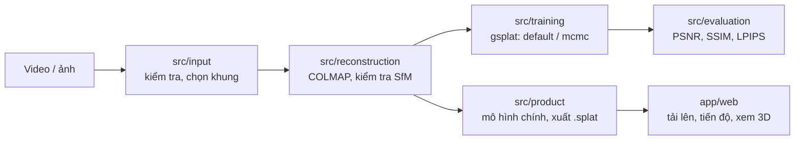
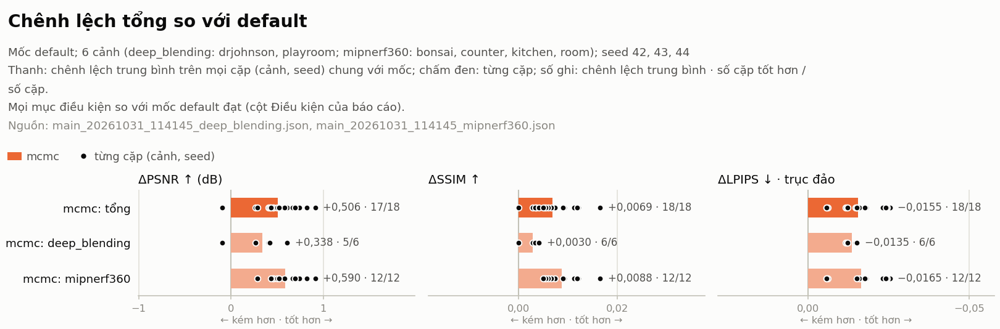
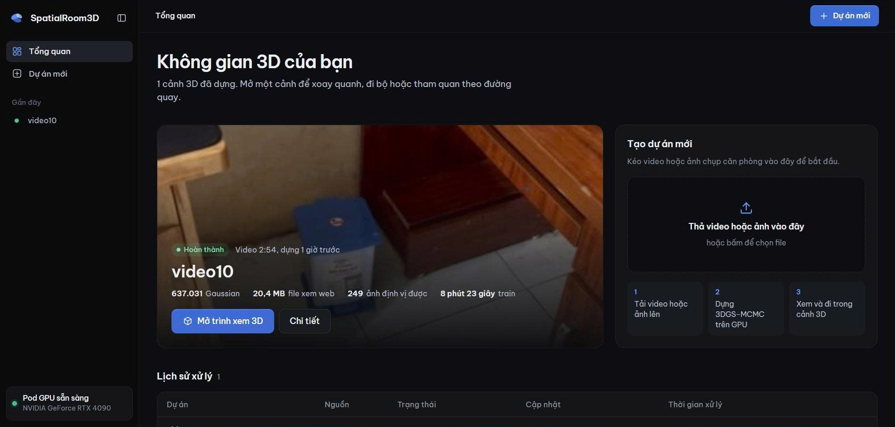

# SpatialRoom3D

**Tái tạo không gian nội thất 3D bằng ảnh chụp** · *3D Indoor Scene Reconstruction from Images*

Đồ án tốt nghiệp. Hệ thống nhận video hoặc ảnh chụp một căn phòng bằng camera điện thoại (không cần LiDAR), ước lượng camera bằng COLMAP, tái tạo cảnh bằng **3D Gaussian Splatting (3DGS)** trên thư viện [gsplat](https://github.com/nerfstudio-project/gsplat), rồi cho xem và đi lại trong cảnh trên trình duyệt. Chất lượng được đánh giá bằng PSNR / SSIM / LPIPS trên ảnh không dùng để huấn luyện.

> **Trạng thái (09/11/2026):** thực nghiệm chính và lượt dò tham số đã chạy trên GPU ngày 31/10/2026. Luồng sản phẩm và trang web đã chạy trên pod ngày 08/11/2026: tải một video lên, dựng phòng `video10` và xem 3D trên trình duyệt; thời gian tải trang và FPS chưa đo. Kết quả: mục 4 và [docs/RESULTS.md](docs/RESULTS.md); bằng chứng và việc tiếp theo: [docs/PROJECT_STATUS.md](docs/PROJECT_STATUS.md).

| Nhóm thực hiện | |
|---|---|
| Trường | Trường Đại học FPT |
| Ngành | Trí tuệ nhân tạo |
| Lớp | AIP491_G31 |
| Năm | 2026 |
| Giảng viên hướng dẫn | Lê Đình Huynh |
| Thành viên | Trần Xuân Trường · Phạm Minh Tiến · Trần Kim Quang · Chu Đình Thắng |

Mục lục: [1. Cấu trúc mã nguồn](#1-cấu-trúc-mã-nguồn) · [2. Cài đặt và chạy](#2-cài-đặt-và-chạy) · [3. Phần nhóm làm và thành phần bên ngoài](#3-phần-nhóm-làm-và-thành-phần-bên-ngoài) · [4. Thực nghiệm và kết quả sơ bộ](#4-thực-nghiệm-và-kết-quả-sơ-bộ) · [5. Tài liệu](#5-tài-liệu)

## 1. Cấu trúc mã nguồn



Nhánh trên là thực nghiệm (so sánh phương pháp), nhánh dưới là sản phẩm (dựng phòng cho web). Hai nhánh dùng chung bước chuẩn bị ảnh và COLMAP.

```
app/
  web/            trang web: server.py (API, tải lên từng phần, hàng đợi dựng phòng, mật khẩu), uploads.py, rooms.py,
                  vendor.py (tải three.js, Spark theo phiên bản ghim), static/ (Tổng quan, Dự án mới, Tiến độ, Xem 3D)
  notebooks/      notebook điều khiển trên Runpod (runpod.ipynb; b0_inria, gsplat_default, gsplat_mcmc)
  cli/            python -m app.cli: một giao diện dòng lệnh cho các bước
src/
  input/          kiểm tra nguồn; chọn khung nét từ video; chuẩn hóa ảnh chụp, giữ tiêu cự EXIF
  reconstruction/ chạy COLMAP 4.x, đọc mô hình, báo cáo kiểm tra trước khi train (Đạt / Đạt có cảnh báo / Không đạt)
  training/       một lượt train / đánh giá trên gsplat, chia train / test, kế hoạch thực nghiệm, biến thể dò tham số,
                  lọc Gaussian, hook cho trainer (biến thể kr, mono)
  evaluation/     đọc kết quả, bảng so sánh, đối chiếu số công bố, thống kê PLY, ảnh và biểu đồ so sánh
  product/        sản phẩm: train mô hình chính, xuất model.splat + cameras.json cho web, ghi tiến độ
  datasets/       đọc configs/*.yaml, tải và kiểm tra dữ liệu benchmark
  rendering/      render lại từ checkpoint, xuất PLY
  utils/          khóa GPU dùng chung với script bash
configs/          base.yaml (protocol, chế độ huấn luyện), product.yaml (mô hình của sản phẩm), một file cho mỗi luồng dữ liệu,
                  experiments/ (kế hoạch thực nghiệm), environment/ (phiên bản ghim của môi trường)
scripts/          lệnh chính (bảng dưới); pod/ (cài đặt, việc nền, thực nghiệm), setup/ (cài môi trường), pipeline/, lib/
tests/            kiểm thử: unit/, helpers/ (dữ liệu tổng hợp, stub thay GPU), browser/ (Chromium headless)
docs/             tài liệu (mục 5)
experiments/      protocol và lệnh của từng benchmark (Deep Blending, Mip-NeRF 360)
```

| Bước | Mã nguồn | Lệnh |
|---|---|---|
| Kiểm tra ảnh / video, chọn khung, COLMAP, kiểm tra trước khi train | `src/input/`, `src/reconstruction/` | `scripts/prepare_data.sh` |
| Huấn luyện 3DGS | `src/training/` | `scripts/run_train.sh` |
| Render lại từ checkpoint, xuất PLY | `src/rendering/` | `scripts/run_render.sh` |
| Lọc Gaussian sau khi train, chấm lại (tùy chọn) | `src/training/prune.py` | `scripts/run_filter.sh` |
| Đánh giá, so sánh các chế độ (bảng và biểu đồ) | `src/evaluation/` | `scripts/run_evaluate.sh` |
| Ảnh so sánh các lượt trên cùng ảnh test | `src/evaluation/panels.py` | `scripts/run_panels.sh` |
| **Sản phẩm**: video / ảnh → mô hình chính → file cho web | `src/product/` | `scripts/build_room.sh` |
| **Trang web**: tải lên, dựng phòng, xem 3D | `app/web/` | `scripts/web_server.sh` |

Dữ liệu, checkpoint và kết quả nằm trên network volume (`/workspace/data/`, `/workspace/outputs/`), không nằm trong repo. Bố cục chi tiết: [docs/design/architecture.md](docs/design/architecture.md).

## 2. Cài đặt và chạy

### 2.1 Yêu cầu

- Pod Runpod (Secure Cloud) có GPU NVIDIA từ 24 GB VRAM, compute capability 8.0 / 8.6 / 8.9 / 9.0 (A100, A6000, RTX 4090, L40S, H100; không dùng Blackwell).
- Driver hỗ trợ CUDA ≥ 12.8; image bản **devel** có `nvcc` 12.x (đã chạy với CUDA 12.4, 12.8 và 12.9).
- Network volume (không phải Global volume) cùng data center, gắn tại `/workspace`; khoảng 100 GB cho thực nghiệm chính.
- Mở cổng HTTP **8888** (Jupyter) và **8000** (trang web) ngay khi tạo pod. Thêm cổng sau bằng Edit Pod sẽ làm pod khởi động lại.

### 2.2 Cài đặt

```bash
git clone https://github.com/truong0809/SpatialRoom3D.git /workspace/SpatialRoom3D
cd /workspace/SpatialRoom3D
bash scripts/pod/run_all.sh --background   # cài và kiểm tra 3 môi trường conda theo phiên bản ghim (không train)
bash scripts/pod/job.sh status             # chờ run_all hiện XONG; log: bash scripts/pod/job.sh log run_all
```

Lần đầu (cài 3 môi trường) mất 37 phút ở lượt ngày 31/10/2026. Khi volume đã có môi trường, `run_all.sh` chỉ kiểm tra lại (3 phút 34 giây ngày 08/11/2026). Cách khác: notebook [`app/notebooks/runpod.ipynb`](app/notebooks/runpod.ipynb), ô 1–5. Từng bước, notebook và xử lý lỗi: [docs/USAGE_GUIDE.md](docs/USAGE_GUIDE.md).

### 2.3 Chạy

```bash
# Sản phẩm: trang web (cổng 8000; lệnh in địa chỉ và mật khẩu) hoặc dựng phòng bằng lệnh
bash scripts/web_server.sh start
bash scripts/build_room.sh <video | thư mục ảnh> <tên_phòng> --name "Tên hiển thị" --background

# Cảnh tự quay (đưa lên /workspace/data/custom_scenes/<cảnh>/): COLMAP → train default, mcmc → tóm tắt kết quả
bash scripts/pod/run_scene.sh /workspace/data/custom_scenes/phong2/phong2.mp4 phong2 --background
bash scripts/pod/run_segments.sh phong2      # chấm lại theo đoạn: ảnh test cách xa ảnh train, 3 seed

# Thực nghiệm (tự tải dữ liệu benchmark còn thiếu): main = thực nghiệm chính, tune_mcmc = dò tham số mcmc
bash scripts/pod/run_experiment.sh main --plan                        # in kế hoạch, không chạy gì
VOLUME_GB=100 bash scripts/pod/run_experiment.sh main --background
VOLUME_GB=100 bash scripts/pod/run_experiment.sh main --only mcmc --background   # một phương pháp: b0, default, mcmc

bash scripts/pod/results.sh                  # xem nhanh kết quả
python3 -m app.cli --help                    # các lệnh trên qua một giao diện dòng lệnh
```

Mỗi lúc chỉ một việc dùng GPU: việc chạy nền (`--background`) tự xếp hàng. Chạy lại an toàn: phần đã xong tự bỏ qua.

### 2.4 Không cần GPU

```bash
python3 -m venv .venv && . .venv/bin/activate && pip install -r requirements.txt
python -m pytest                             # Linux, Python 3.10–3.13

# xem các phòng đã dựng trên laptop (chép thư mục outputs/product/web/ về; không cần mạng)
python3 -m app.web.server --web-dir <thư mục web> --view-only --host 127.0.0.1 --no-auth --port 8000
```

Vài test tích hợp cần `ffmpeg` và `colmap`, tự bỏ qua khi máy không có. Test của các script bash chạy bash thật với stub thay cho GPU và conda.

## 3. Phần nhóm làm và thành phần bên ngoài

### 3.1 Nhóm tự viết

Toàn bộ mã trong `src/`, `app/`, `scripts/`, `configs/` và `tests/`: luồng xử lý từ video / ảnh đến mô hình 3D (chọn khung, kiểm tra đầu vào, chạy COLMAP và kiểm tra chất lượng trước khi tốn GPU); khung thực nghiệm (cùng số Gaussian, cùng tập test, nhiều seed, kiểm chứng baseline với số công bố, ngưỡng ghi trước khi có số liệu); 16 biến thể dò tham số; công cụ đánh giá; luồng sản phẩm và bộ xuất `.splat`; trang web và trình xem 3D; hạ tầng chạy trên pod (cài đặt, việc nền, khóa GPU); bộ kiểm thử. Không có mã của bên thứ ba được chép vào các thư mục này; `docs/research/references/demo_3dgs_mcmc/` lưu nguyên notebook demo 1 của nhóm để đối chiếu (mục 3.3).

### 3.2 Thành phần bên ngoài

Cài vào môi trường trên pod theo phiên bản ghim (thư viện của trang web vào `app/web/static/vendor/` bằng `python3 -m app.web.vendor`), không chép vào repo, không sửa:

| Thành phần | Vai trò | Phiên bản | License |
|---|---|---|---|
| [gsplat](https://github.com/nerfstudio-project/gsplat) | Huấn luyện 3DGS và 3DGS-MCMC | commit `6e8c837` | Apache-2.0 |
| [3DGS gốc của Inria](https://github.com/graphdeco-inria/gaussian-splatting) | Mốc đối chiếu B0 | commit `54c035f` | Gaussian-Splatting License, chỉ dùng phi thương mại cho nghiên cứu và đánh giá |
| [COLMAP](https://github.com/colmap/colmap) | Ước lượng camera | 4.2.1 (conda-forge) | BSD (thư viện đi kèm có license riêng) |
| [Depth Anything V2](https://github.com/DepthAnything/Depth-Anything-V2) | Prior độ sâu, chỉ biến thể `mono` | commit `a561b84`, trọng số bản Small | Apache-2.0 (bản Small) |
| [three.js](https://github.com/mrdoob/three.js) | Trang web: cảnh 3D, điều khiển camera | 0.180.0 (`configs/environment/web_viewer.lock.json`) | MIT |
| [Spark](https://github.com/sparkjsdev/spark) | Trang web: vẽ 3D Gaussian Splatting | 2.4.0, như trên | MIT |
| [Be Vietnam Pro](https://www.npmjs.com/package/@fontsource/be-vietnam-pro) | Phông chữ của trang web | 5.3.0, như trên | SIL OFL 1.1 |

### 3.3 Chỗ dựa trên mã hoặc thiết kế bên ngoài

| Chỗ | Dựa trên | Nhóm làm gì |
|---|---|---|
| Huấn luyện (`src/training/gsplat_launcher.py`, `src/product/train_main.py`) | `examples/simple_trainer.py` của gsplat | Gọi trainer với preset `default` / `mcmc`, thêm seed, tập train / test, ghi cấu hình; không sửa file |
| Biến thể `kr`, `mono` (`src/training/trainer_hooks.py`) | `simple_trainer.py` của gsplat | Lúc chạy tạo **bản sao có vá** trong thư mục kết quả, chèn 4 dòng có đánh dấu `[SR3D]`: yêu cầu render độ sâu, giữ bản đồ độ sâu, cộng loss độ sâu đơn ảnh (loss Pearson theo FSGS), gọi Kill-then-Relocate trước bước của MCMC. Mỗi chỗ chèn phải khớp đúng một lần, không thì dừng trước khi train |
| Chạy COLMAP (`src/reconstruction/colmap_runner.py`) | Các bước của `convert.py` (Inria) | Viết lại theo tên tùy chọn mới của COLMAP 4; thêm báo cáo kiểm tra trước khi train (`src/reconstruction/report.py`) |
| Xuất web (`src/product/export_web.py`) | Định dạng `.splat` của [antimatter15/splat](https://github.com/antimatter15/splat) | Tự viết bộ xuất từ PLY, cùng cách sắp xếp Gaussian |
| Biến thể `kr`, `mono`, `bilagrid` của lượt dò tham số | Notebook demo v2 của nhóm ([`docs/research/references/demo_3dgs_mcmc/3D_demo_v2.ipynb`](docs/research/references/demo_3dgs_mcmc/3D_demo_v2.ipynb); bản v4 giống hệt, chỉ khác 30.000 vòng). `bilagrid` là cờ có sẵn của gsplat; `mono` dùng Depth Anything V2 và loss Pearson như FSGS | Đưa về giao thức chung (30.000 vòng, cùng số Gaussian), mỗi biến thể thêm đúng một thành phần (`docs/design/experiments.md` mục 3.7) |

**Demo 1** ([`docs/research/references/demo_3dgs_mcmc/3D_demo.ipynb`](docs/research/references/demo_3dgs_mcmc/3D_demo.ipynb): notebook Colab chạy ngày 03/10/2026, 3DGS-MCMC 40.000 vòng, tham khảo repo [Ziro21/SpatialScene3D](https://github.com/Ziro21/SpatialScene3D)) là điểm xuất phát của đồ án. Repo này giữ chiến lược 3DGS-MCMC của demo và viết lại các phần còn lại (cài đặt theo phiên bản ghim, chọn khung, COLMAP, đánh giá, xuất web, trình xem); không chép code của SpatialScene3D. Bộ tham số riêng của demo (40.000 vòng, `cap_max` 3,5 triệu, antialiased) không dùng: đưa về giao thức chung thì demo chỉ còn khác `mcmc` ở `refine_stop_iter`, đã đo bằng biến thể `rs30k`. Số liệu của demo (PSNR 39,97 dB, LPIPS AlexNet, ảnh test xen kẽ trong cùng video, một lượt) không dùng làm kết quả. Đối chiếu chi tiết: [docs/research/demo_review.md](docs/research/demo_review.md).

### 3.4 Phương pháp, dữ liệu và chỉ số lấy từ paper

| Paper | Dùng ở đâu | Nhóm làm gì |
|---|---|---|
| 3DGS: Kerbl et al., ACM TOG 2023 | Chế độ `default` (baseline), B0 | Chạy qua gsplat và mã của Inria, không đổi thuật toán |
| 3DGS-MCMC: Kheradmand et al., NeurIPS 2024 | Chế độ `mcmc`, mô hình chính của sản phẩm | Chạy qua gsplat; so với `default` ở cùng số Gaussian như paper; dò 16 biến thể |
| gsplat: Ye et al., JMLR 2025 | Thư viện huấn luyện | Ghim commit, không sửa |
| COLMAP: Schönberger & Frahm, CVPR 2016 | Ước lượng camera | Viết bước chạy và bước kiểm tra chất lượng |
| Bilateral grid: Wang et al., ACM TOG 2024 | Biến thể `bilagrid` | Bật cờ có sẵn của gsplat, đo theo giao thức chung |
| Depth Anything V2: Yang et al., NeurIPS 2024; FSGS: Zhu et al., ECCV 2024 | Biến thể `mono` (prior độ sâu đơn ảnh, loss Pearson của FSGS) | Tính prior, kiểm độ tin cậy bằng điểm SfM, viết loss trong hook |
| Mip-NeRF 360: Barron et al., CVPR 2022; Deep Blending: Hedman et al., ACM TOG 2018 | Dữ liệu benchmark (4 + 2 cảnh trong nhà) | Tải, ghi SHA-256, chạy theo protocol của Inria (mỗi ảnh thứ tám làm ảnh test) |
| SSIM: Wang et al., IEEE TIP 2004; LPIPS: Zhang et al., CVPR 2018 | Chỉ số đánh giá (cùng PSNR) | Tính bằng mã của gsplat, LPIPS VGG như Inria |

Kill-then-Relocate (biến thể `kr`) là heuristic của notebook demo v2 của nhóm, không có paper. Các bài khác trong [docs/research/reading_list.md](docs/research/reading_list.md) là tài liệu khảo sát: dùng để so sánh và chọn hướng, không lấy mã hay phương pháp.

## 4. Thực nghiệm và kết quả sơ bộ

| Chế độ | Phương pháp | Vai trò |
|---|---|---|
| `default` | 3DGS (Kerbl et al., 2023), `DefaultStrategy` của gsplat | Baseline; đối chiếu với 3DGS gốc của Inria (B0) |
| `mcmc` | 3DGS-MCMC (Kheradmand et al., 2024), `MCMCStrategy` của gsplat | Cùng protocol, cùng số Gaussian cuối với `default` trên cùng cảnh, cùng seed |

**Thiết lập:** 6 cảnh trong nhà, Deep Blending (`drjohnson`, `playroom`) và Mip-NeRF 360 (`room`, `counter`, `kitchen`, `bonsai`); 3 seed; 30.000 vòng; mỗi ảnh thứ tám làm ảnh test như mã của Inria; RTX 4090. Kết quả do nhóm tự chạy ngày 31/10/2026:

- **Kiểm chứng baseline (đạt):** `default` lệch −0,168 dB PSNR so với số công bố của Inria trên Deep Blending, −0,339 / −0,136 dB so với B0 nhóm tự chạy; ngưỡng 0,5 dB.
- **So sánh chính:** `mcmc` tốt hơn `default` ở 17/18 cặp (cảnh, seed) về PSNR và 18/18 cặp về SSIM, LPIPS; trung bình +0,590 ± 0,181 dB trên Mip-NeRF 360, +0,338 ± 0,239 dB trên Deep Blending; thời gian huấn luyện tương đương. Đây là căn cứ chọn `mcmc` cho sản phẩm.
- **Dò 16 biến thể của `mcmc`** (cảnh `room`, một seed, ngưỡng 0,150 dB ghi trước): không biến thể nào tốt hơn rõ ràng; sản phẩm giữ nguyên preset `mcmc`.
- **Phòng nhóm tự quay:** chạy được đủ luồng; PSNR khoảng 39 dB không dùng để kết luận vì ảnh test nằm sát ảnh train của cùng video. Đánh giá theo đoạn (`scripts/pod/run_segments.sh`) đã viết, chưa chạy trên GPU.
- **Sản phẩm trên pod** (08/11/2026, RTX 4090): tải một video 2 phút 54 giây lên trang web, pod dựng phòng `video10` (249 ảnh định vị, `model.splat` 637.031 Gaussian, 20,4 MB, train 8 phút 23 giây), xem được 3D trên trình duyệt. Thời gian các bước khác, thời gian tải trang và FPS chưa đo. Video demo (quay màn hình, 11 phút): [Google Drive](https://drive.google.com/file/d/1FG4LS7gpBTIIer8L2jTSQQHPk12BszV4/view).


*Chênh lệch của `mcmc` so với `default`: thanh là trung bình, chấm đen là từng cặp (cảnh, seed).*


*Trang Tổng quan khi chạy trên pod (08/11/2026): phòng `video10` dựng từ một video 2 phút 54 giây.*

Bảng đầy đủ theo cảnh, biểu đồ và ảnh so sánh: [docs/RESULTS.md](docs/RESULTS.md). Bằng chứng và giới hạn: [docs/PROJECT_STATUS.md](docs/PROJECT_STATUS.md) mục "Kết quả". Thiết kế thực nghiệm: [docs/design/experiments.md](docs/design/experiments.md), [docs/design/training_modes.md](docs/design/training_modes.md).

## 5. Tài liệu

| | |
|---|---|
| [docs/USAGE_GUIDE.md](docs/USAGE_GUIDE.md) | Hướng dẫn sử dụng trên Runpod: volume, pod, notebook, cảnh tự quay, benchmark, xử lý lỗi |
| [docs/RESULTS.md](docs/RESULTS.md) | Kết quả tóm tắt: thực nghiệm chính, kiểm chứng baseline, dò tham số, phòng của nhóm (31/10/2026), sản phẩm trên pod (08/11/2026) |
| [docs/PROJECT_STATUS.md](docs/PROJECT_STATUS.md) | Trạng thái, quyết định đã chốt, kết quả, bằng chứng, việc tiếp theo |
| [docs/design/product.md](docs/design/product.md) | Sản phẩm: mô hình chính, dựng phòng, hợp đồng với web (file, định dạng, hệ tọa độ, tiến độ) |
| [app/web/README.md](app/web/README.md) | Trang web: chạy trên pod, xem trên laptop không cần pod, các màn, kiểm thử |
| [docs/ENVIRONMENT_AUDIT.md](docs/ENVIRONMENT_AUDIT.md) | Môi trường, phiên bản ghim, lượt chạy trên pod, sự cố đã biết |
| [docs/data/capture_protocol.md](docs/data/capture_protocol.md) | Quy trình quay video và chụp ảnh nội thất |
| [docs/README.md](docs/README.md) | Mục lục đầy đủ |

## Giấy phép

Mã nguồn của repo dùng giấy phép [MIT](LICENSE). Các thành phần bên ngoài ở mục 3.2 giữ giấy phép riêng của chúng; riêng 3DGS gốc của Inria (B0) chỉ được dùng phi thương mại cho nghiên cứu và đánh giá, và không được chép vào repo.

## Quy ước

- Không đưa dataset, checkpoint, `.ply`, video hay log thô lên Git; không đưa token, mật khẩu, API key hay file `.env`.
- Mọi số liệu trong báo cáo phải truy được về file kết quả, cấu hình và commit tương ứng; số công bố và số tự chạy luôn ghi tách bạch.
- Dữ liệu trong `tests/` là dữ liệu tổng hợp để kiểm tra logic, không phải kết quả thực nghiệm.
- Commit message dạng `loại(phạm vi): mô tả`, phạm vi có thể bỏ (vd. `docs: ...`).
