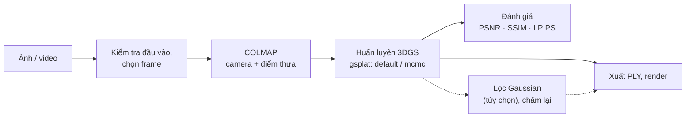

# SpatialRoom3D

**Tái tạo không gian nội thất 3D bằng ảnh chụp** · *3D Indoor Scene Reconstruction from Images*

Đồ án tốt nghiệp. Hệ thống nhận ảnh hoặc video quay một không gian nội thất bằng camera thông thường (không cần LiDAR), ước lượng camera bằng COLMAP, tái tạo cảnh bằng **3D Gaussian Splatting (3DGS)** trên [gsplat](https://github.com/nerfstudio-project/gsplat), xuất mô hình `.ply` để xem trên trình xem 3DGS và đánh giá chất lượng bằng PSNR / SSIM / LPIPS.

> **Trạng thái:** repo này đã kiểm thử trên CPU, chưa chạy trên pod; thực nghiệm chính và bước dò tham số chưa chạy. Số đo GPU tham khảo với cùng mã huấn luyện (B0 đạt ngưỡng trên Deep Blending; `default` / `mcmc`, một seed): [docs/ENVIRONMENT_AUDIT.md](docs/ENVIRONMENT_AUDIT.md) mục 7. Bằng chứng và việc tiếp theo: [docs/PROJECT_STATUS.md](docs/PROJECT_STATUS.md).

## Luồng xử lý



| Bước | Mã nguồn | Lệnh |
|---|---|---|
| Kiểm tra ảnh / video, chọn frame, COLMAP, kiểm tra trước khi train | `src/input/`, `src/reconstruction/` | `scripts/prepare_data.sh` |
| Huấn luyện 3DGS | `src/training/` | `scripts/run_train.sh` |
| Render lại từ checkpoint, xuất PLY | `src/rendering/` | `scripts/run_render.sh` |
| Lọc Gaussian sau khi train, chấm lại (tùy chọn) | `src/training/prune.py` | `scripts/run_filter.sh` |
| Đánh giá, so sánh các chế độ | `src/evaluation/` | `scripts/run_evaluate.sh` |

Ảnh chụp được dùng thẳng; video được chọn frame nét. Trước khi train, cảnh được kiểm tra số ảnh, tỉ lệ ảnh COLMAP ghép được, việc tách nhóm và độ phủ góc nhìn.

## Chế độ huấn luyện

| Chế độ | Phương pháp | Vai trò |
|---|---|---|
| `default` | 3DGS (Kerbl et al., 2023), `DefaultStrategy` của gsplat | Baseline; được đối chiếu với 3DGS gốc của Inria (B0) trên Deep Blending |
| `mcmc` | 3DGS-MCMC (Kheradmand et al., 2024), `MCMCStrategy` của gsplat | Cùng protocol, cùng số Gaussian cuối với `default` trên cùng cảnh |

Thực nghiệm chính so sánh hai chế độ trên 6 cảnh trong nhà: Deep Blending (`drjohnson`, `playroom`) và Mip-NeRF 360 (`room`, `counter`, `kitchen`, `bonsai`), 3 seed, 30.000 vòng. Bước dò tham số (`tune_mcmc`: 10 biến thể của `mcmc` trên `room`, một seed, kèm lọc Gaussian) dùng để chọn tham số cho một chế độ thứ ba `mcmc_indoor`, sẽ được thêm vào thực nghiệm chính khi có số liệu; đây là tinh chỉnh tham số trên phương pháp có sẵn, không phải thuật toán mới. Thiết kế: [docs/design/training_modes.md](docs/design/training_modes.md), [docs/design/experiments.md](docs/design/experiments.md).

## Chạy trên Runpod

Cần một pod Secure Cloud có GPU NVIDIA từ 24 GB VRAM (Ampere, Ada hoặc Hopper), driver hỗ trợ CUDA ≥ 12.8, gắn network volume cùng data center tại `/workspace`. Cách dễ nhất là notebook [`app/notebooks/runpod.ipynb`](app/notebooks/runpod.ipynb), làm theo [docs/USAGE_GUIDE.md](docs/USAGE_GUIDE.md). Chạy bằng lệnh, từ `/workspace/SpatialRoom3D`:

```bash
bash scripts/pod/run_all.sh --background      # cài và kiểm tra 3 env conda (không train, không tải dữ liệu)
bash scripts/pod/job.sh status                # theo dõi việc chạy nền; log: bash scripts/pod/job.sh log <tên>

# Cảnh tự chụp (đưa lên /workspace/data/custom_scenes/<cảnh>/): COLMAP → train default, mcmc → tóm tắt kết quả
bash scripts/pod/run_scene.sh /workspace/data/custom_scenes/phong1 phong1 --background             # thư mục ảnh
bash scripts/pod/run_scene.sh /workspace/data/custom_scenes/phong2/phong2.mp4 phong2 --background  # file video

# Thực nghiệm (tự tải dữ liệu benchmark còn thiếu): main = thực nghiệm chính, tune_mcmc = dò tham số mcmc
bash scripts/pod/run_experiment.sh main --plan                       # in kế hoạch, ước lượng (không chạy gì)
VOLUME_GB=100 bash scripts/pod/run_experiment.sh main --background   # chạy thực nghiệm trong một việc nền
VOLUME_GB=100 bash scripts/pod/run_experiment.sh tune_mcmc --background
bash scripts/run_filter.sh custom phong1 mcmc_s42                    # lọc Gaussian một lượt rồi chấm lại

bash scripts/pod/results.sh                   # xem nhanh kết quả
python3 -m app.cli --help                     # các lệnh trên qua một giao diện dòng lệnh
```

- Mỗi lúc chỉ một việc dùng GPU: việc chạy nền (`--background`, `job.sh start`) tự xếp hàng; lệnh chạy trực tiếp thì dừng và báo khi GPU đang bận.
- Chạy lại an toàn: phần đã xong tự bỏ qua.
- Lệnh train một benchmark riêng lẻ không tự tải dữ liệu: tải trước bằng `bash scripts/pod/fetch_data.sh <benchmark>`.
- Từng bước riêng lẻ (chuẩn bị, train, render, đánh giá) và cách xử lý lỗi: [docs/USAGE_GUIDE.md](docs/USAGE_GUIDE.md).

## Kiểm thử trên máy không có GPU

Linux, Python 3.10–3.13:

```bash
python3 -m venv .venv && . .venv/bin/activate
pip install -r requirements.txt
python -m pytest
```

Vài test tích hợp cần `ffmpeg` và `colmap`, tự bỏ qua khi máy không có. Test của các script bash chạy bash thật với stub thay cho GPU và conda, cần `flock`, `setsid` và `/proc`.

## Cấu trúc thư mục

```
app/           giao diện dòng lệnh (python -m app.cli), notebook cho Runpod, giao diện web (chưa làm)
src/           package chính: input, reconstruction, training, rendering, evaluation, datasets, utils
configs/       base.yaml (chế độ huấn luyện, protocol), một file cho mỗi luồng dữ liệu,
               experiments/ (kế hoạch thực nghiệm), environment/ (phiên bản ghim của các env conda)
scripts/       bốn lệnh chính; pipeline/ (phần thực thi), pod/ (chạy trên pod), setup/ (cài môi trường), lib/
tests/         kiểm thử: test_dataset.py, test_pipeline.py, unit/, helpers/
docs/          tài liệu, mục lục ở docs/README.md
experiments/   protocol và lệnh của từng benchmark (Deep Blending, Mip-NeRF 360)
```

Dữ liệu, checkpoint và kết quả nằm trên network volume (`/workspace/data/`, `/workspace/outputs/`), không nằm trong repo. Bố cục chi tiết: [docs/design/architecture.md](docs/design/architecture.md).

## Tài liệu

| | |
|---|---|
| [docs/USAGE_GUIDE.md](docs/USAGE_GUIDE.md) | Hướng dẫn sử dụng trên Runpod |
| [docs/PROJECT_STATUS.md](docs/PROJECT_STATUS.md) | Trạng thái, quyết định đã chốt, bằng chứng, việc tiếp theo |
| [docs/PROJECT_PLAN.md](docs/PROJECT_PLAN.md) | Đề bài, phạm vi, phương pháp, mốc nghiệm thu |
| [docs/ENVIRONMENT_AUDIT.md](docs/ENVIRONMENT_AUDIT.md) | Môi trường, phiên bản ghim, sự cố đã biết |
| [docs/README.md](docs/README.md) | Mục lục đầy đủ |

## Thành phần bên ngoài

Các thành phần dưới đây được cài vào môi trường trên pod theo phiên bản ghim, không chép vào repo:

| Thành phần | Phiên bản | License |
|---|---|---|
| [gsplat](https://github.com/nerfstudio-project/gsplat) | commit `6e8c837` | Apache-2.0 |
| [3DGS gốc của Inria](https://github.com/graphdeco-inria/gaussian-splatting) (B0, chỉ để đối chiếu) | commit `54c035f` | Gaussian-Splatting License, chỉ dùng phi thương mại cho nghiên cứu và đánh giá |
| [COLMAP](https://github.com/colmap/colmap) | 4.2.1 (conda-forge) | BSD cho riêng COLMAP; các thư viện đi kèm (vd. SiftGPU) có license riêng |

## Quy ước

- Không đưa dataset, checkpoint, `.ply`, video hay log thô lên Git; không đưa token, mật khẩu, API key hay file `.env`.
- Mọi số liệu trong báo cáo phải truy được về file kết quả, cấu hình và commit tương ứng; số công bố và số tự chạy luôn ghi tách bạch.
- Dữ liệu trong `tests/` là dữ liệu tổng hợp để kiểm tra logic, không phải kết quả thực nghiệm.
- Commit message dạng `loại(phạm vi): mô tả`, phạm vi có thể bỏ (vd. `docs: ...`).
