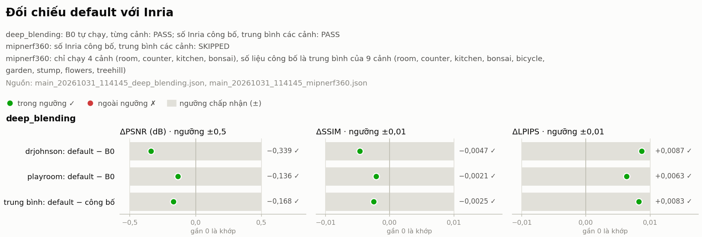
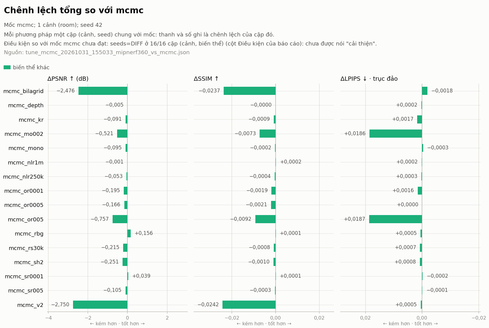

# Kết quả tóm tắt

Tóm tắt kết quả của lượt chạy trên pod ngày **31/10/2026**, để repo vẫn giữ bằng chứng chính khi volume Runpod không còn. File này chỉ chép lại số từ các báo cáo gốc, không tính lại.

- Code: commit `c0a7a92`.
- Báo cáo gốc trên volume: `outputs/reports/main_20261031_114145*.md`, `tune_mcmc_20261031_155033*.md`, `compare_custom_20261031_214710.md`; gói kết quả `ket_qua_main_20261031_114145.tar.gz`, `ket_qua_tune_mcmc_20261031_155033.tar.gz`.
- Trạng thái và quyết định: [PROJECT_STATUS.md](PROJECT_STATUS.md). Thiết kế thực nghiệm: [design/experiments.md](design/experiments.md).

## 1. Thiết lập

| Hạng mục | Giá trị |
|---|---|
| Phương pháp | `default`: 3DGS, `DefaultStrategy` của gsplat (baseline) · `mcmc`: 3DGS-MCMC, `MCMCStrategy` của gsplat |
| Điều kiện so sánh | Cùng số Gaussian cuối cho hai chế độ trên cùng cảnh |
| Bộ dữ liệu | Deep Blending: `drjohnson`, `playroom` · Mip-NeRF 360: `bonsai`, `counter`, `kitchen`, `room` (4/9 cảnh) |
| Seed | 42, 43, 44 |
| Huấn luyện | 30.000 vòng; camera pinhole; khởi tạo từ điểm SfM; SH bậc 3; trọng số SSIM 0,2; xuất PLY ở vòng 30.000 |
| `mcmc` | Dời và thêm Gaussian mỗi 100 vòng, từ vòng 500 đến 25.000 |

## 2. Thực nghiệm chính: `mcmc` so với `default`

**Kết luận:** `mcmc` tốt hơn `default` ở **17/18** cặp (cảnh, seed) về PSNR, **18/18** về SSIM và LPIPS.

### 2.1. Trung bình theo bộ dữ liệu (các cảnh × 3 seed)

| Bộ dữ liệu | Chế độ | PSNR ↑ | SSIM ↑ | LPIPS ↓ |
|---|---|---:|---:|---:|
| Deep Blending | `default` | 29,522 | 0,904 | 0,246 |
| Deep Blending | `mcmc` | **29,860** | **0,906** | **0,233** |
| Mip-NeRF 360 (4 cảnh) | `default` | 31,130 | 0,930 | 0,166 |
| Mip-NeRF 360 (4 cảnh) | `mcmc` | **31,719** | **0,939** | **0,150** |

| Phạm vi | ΔPSNR (dB) · số cặp tốt hơn | ΔSSIM · số cặp | ΔLPIPS · số cặp |
|---|---|---|---|
| **Tổng 6 cảnh** | **+0,506 · 17/18** | **+0,0069 · 18/18** | **−0,0155 · 18/18** |
| Deep Blending | +0,338 ± 0,239 · 5/6 | +0,0030 · 6/6 | −0,0135 · 6/6 |
| Mip-NeRF 360 | +0,590 ± 0,181 · 12/12 | +0,0088 · 12/12 | −0,0165 · 12/12 |


*Chênh lệch của `mcmc` so với `default`: thanh là trung bình, chấm đen là từng cặp (cảnh, seed). Nguồn: `main_20261031_114145_deep_blending.json`, `main_20261031_114145_mipnerf360.json`.*


*Riêng 4 cảnh Mip-NeRF 360. Nguồn: `modes_mipnerf360_20261031_044043.json`.*

### 2.2. Theo từng cảnh

Δ = `mcmc` − `default`, trung bình 3 seed (PSNR, SSIM: dương là tốt hơn; LPIPS: âm là tốt hơn).

| Cảnh | Bộ dữ liệu | ΔPSNR (dB) | ΔSSIM | ΔLPIPS | σ PSNR `default` / `mcmc` |
|---|---|---:|---:|---:|---|
| drjohnson | Deep Blending | +0,480 | +0,0034 | −0,0120 | 0,017 / 0,096 |
| playroom | Deep Blending | +0,197 | +0,0026 | −0,0150 | 0,085 / 0,294 |
| room | Mip-NeRF 360 | +0,809 | +0,0118 | −0,0246 | 0,060 / 0,137 |
| counter | Mip-NeRF 360 | +0,544 | +0,0116 | −0,0195 | 0,193 / 0,026 |
| kitchen | Mip-NeRF 360 | +0,435 | +0,0052 | −0,0058 | 0,083 / 0,123 |
| bonsai | Mip-NeRF 360 | +0,571 | +0,0067 | −0,0158 | 0,034 / 0,082 |

- Ở `playroom`, ΔPSNR nhỏ hơn dao động giữa các seed của `mcmc`.
- Deep Blending dùng `opacity_reg` 0,001 cho `mcmc` ở cả hai cảnh (bài báo 3DGS-MCMC chỉ ghi giá trị này cho `drjohnson`).

## 3. Kiểm chứng baseline

| Phép đối chiếu | Kết quả |
|---|---|
| `default` so với số Inria công bố, Deep Blending | **PASS**: PSNR −0,168 dB, SSIM −0,002, LPIPS +0,008 (trung bình) |
| `default` so với B0 (3DGS gốc của Inria, tự chạy) | **PASS**: drjohnson −0,339 dB, playroom −0,136 dB |
| Mip-NeRF 360 so với số công bố | **SKIPPED**: mới chạy 4/9 cảnh, không so được với trung bình 9 cảnh |


*Đối chiếu `default` với B0 tự chạy (từng cảnh) và với số Inria công bố (trung bình); vùng xám là ngưỡng chấp nhận (±0,5 dB, ±0,01, ±0,01).*

## 4. Chi phí tính toán

| Hạng mục | Giá trị |
|---|---|
| Thời gian train | Khoảng 12–18 phút mỗi lượt (cảnh, seed) trong thực nghiệm chính |
| Thời gian train `mcmc` so với `default` | ×0,98–1,10 |
| VRAM đỉnh | Khoảng 3–7,5 GiB; `mcmc` thấp hơn `default` 0,1–0,9 GiB |
| Thời gian render | Khoảng 28–56 ms mỗi ảnh, **có tính cả lần gọi CUDA đầu tiên**, không quy đổi trực tiếp thành FPS |

Số Gaussian và dung lượng PLY (như nhau cho hai chế độ vì cùng số Gaussian cuối):

| Cảnh | Số Gaussian | PLY |
|---|---:|---:|
| bonsai | 1.246.905 | 281 MB |
| counter | 1.178.331 | 265 MB |
| kitchen | 1.795.468 | 404 MB |
| room | 1.565.594 | 352 MB |
| drjohnson | 3.552.082 | 799 MB |
| playroom | 2.346.733 | 528 MB |

## 5. Dò tham số `mcmc` (`tune_mcmc`)

16 biến thể của `mcmc` trên `room`, **một seed (42)**: depth loss, random background, `opacity_reg` / `scale_reg`, noise learning rate, bậc SH, bilateral grid, Kill-then-Relocate, depth prior và gói `v2`. Ngưỡng coi là khác biệt thật: d = 0,150 dB (PSNR) / 0,0012 (SSIM) / 0,0018 (LPIPS).

| Nhóm | Biến thể |
|---|---|
| Hơn `mcmc` quá ngưỡng | `rbg` (random background): PSNR 32,764, hơn `mcmc` +0,156 dB, sát ngưỡng |
| Trong mức dao động | `sr0001` (PSNR 32,646), `depth` (PSNR 32,603), `nlr1m`, `nlr250k`, `kr`, `mono`, `sr005` |
| Kém hơn quá ngưỡng | `or0005`, `or0001`, `rs30k`, `sh2`, `mo002`, `or005`, `bilagrid` (−2,476 dB), `v2` (−2,750 dB) |

- `sr0001` và `depth` có PSNR cao nhưng **chưa vượt ngưỡng**, nên chưa được coi là tốt hơn `mcmc`.
- Chỉ một seed, nên chưa đủ cơ sở kết luận chính thức; vòng ghép với seed mới đã bỏ (D25, `design/experiments.md` mục 3.6), sản phẩm giữ preset `mcmc`.
- `bilagrid` và `v2` giảm mạnh PSNR nhưng LPIPS gần như không đổi. Giả thuyết chưa kiểm: lệch màu vì ảnh test được chấm mà không đi qua bilateral grid.

**Lọc Gaussian sau khi train** (bỏ Gaussian có opacity < 0,02 hoặc trục > 0,1 × `scene_scale`), rồi chấm lại: `default` giảm 1,14 dB; `mcmc` và các biến thể giảm 2,1 đến 9,1 dB. Kết luận: không dùng bộ lọc này để làm nhẹ file cho `mcmc`.


*Từng biến thể so với `mcmc` (cùng seed 42). Báo cáo ghi điều kiện "seeds=DIFF" chưa đạt ở 16/16 cặp, nên **chưa được nói "cải thiện"**.*


*Các biến thể so với `default` trên `room` (`mcmc` có 3 seed, các biến thể 1 seed).*

## 6. Phòng của nhóm (`phong_nhom`)

Một video tự quay, 1 seed.

| Chế độ | PSNR | SSIM | LPIPS |
|---|---:|---:|---:|
| `default` | 39,318 | 0,9769 | 0,0959 |
| `mcmc` | 39,069 | 0,9788 | 0,0873 |

Hai chế độ trái chiều nhau (PSNR nghiêng về `default`; SSIM, LPIPS nghiêng về `mcmc`). Ảnh test là các khung kề khung train của cùng video, nên số này **không so được với benchmark** và cao hơn mức thật khi nhìn từ góc mới.


*ΔPSNR −0,250 dB, ΔSSIM +0,0019, ΔLPIPS −0,0086 (1 seed). Báo cáo ghi điều kiện "seeds=FEW" chưa đạt, nên chưa được nói "cải thiện". Nguồn: `compare_custom_20261031_214710.json`.*

## 7. Sản phẩm chạy trên pod (08/11/2026)

Lần đầu chạy trọn luồng sản phẩm trên GPU: tải video lên trang web → pod chạy `scripts/build_room.sh` với mô hình chính `mcmc` → xem 3D trên trình duyệt. Số liệu lấy từ trang Tổng quan của web.

| Hạng mục | Giá trị |
|---|---|
| Phòng | `video10` |
| Đầu vào | Một video dài 2 phút 54 giây |
| Ảnh COLMAP định vị được | 249 |
| Số Gaussian | 637.031 |
| File xem web (`model.splat`) | 20,4 MB |
| Thời gian train | 8 phút 23 giây |
| GPU | NVIDIA GeForce RTX 4090 |
| Trạng thái | Hoàn thành, mở được trong trình xem 3D |


Video demo (quay màn hình, 11 phút, ngày 08/11/2026): [xem trên Google Drive](https://drive.google.com/file/d/1FG4LS7gpBTIIer8L2jTSQQHPk12BszV4/view); file không đưa lên Git.

Chưa đo: thời gian của từng bước còn lại (chọn frame, COLMAP, xuất file), thời gian tải trang và FPS trên máy xem. Cần kiểm tra thêm: số Gaussian (637.031) thấp hơn `cap_max` 1.000.000 của `configs/product.yaml`. Đây là số Gaussian trong `model.splat`. Giả thuyết chưa kiểm: train đủ 1.000.000, bước xuất bỏ các Gaussian trong suốt hoàn toàn; kiểm bằng `num_gaussians_trained` trong `manifest.json` của web (`PROJECT_STATUS.md` mục "Còn mở").

## 8. Môi trường

| Hạng mục | Giá trị |
|---|---|
| GPU | NVIDIA GeForce RTX 4090 (dung lượng VRAM: xem `docs/ENVIRONMENT_AUDIT.md` mục 7) |
| CUDA, PyTorch | CUDA toolkit 12.8; PyTorch 2.7.1 + CUDA 12.8 |
| Hệ điều hành, Python | Ubuntu 22.04.5; Python 3.10 |
| Phiên bản ghim | gsplat commit `6e8c837`; 3DGS Inria commit `54c035f` |

## 9. Lựa chọn rút ra và giới hạn

- `mcmc` được chọn làm **mô hình chính của sản phẩm** (`configs/product.yaml`). Lựa chọn này, việc không xét gói `v2` như một ứng viên và việc bỏ vòng ghép (D25) được chốt **sau khi đã có kết quả**; báo cáo phải ghi rõ.
- Đóng góp là **tích hợp và đánh giá các kỹ thuật có sẵn** cộng một heuristic, không phải thuật toán mới.
- Chưa có: thời gian từng bước của luồng sản phẩm (ngoài thời gian train), thời gian tải và FPS của trang web, điểm đánh giá cho phòng tự dựng từ góc nhìn mới, 5/9 cảnh còn lại của Mip-NeRF 360. Danh sách đầy đủ: [PROJECT_STATUS.md](PROJECT_STATUS.md) mục "Còn mở".

## 10. Ảnh so sánh từng ảnh test

Mỗi ảnh gồm ba hàng: ảnh thật, `default` (seed 42), `mcmc` (seed 42); cột giữa là vùng phóng to (khung đỏ), cột phải là sai số tuyệt đối ×4 (càng sáng càng sai). PSNR ghi trên ảnh là của **riêng ảnh đó**, có thể khác chiều với kết quả trung bình ở mục 2.

| Ảnh | Cảnh | PSNR `default` | PSNR `mcmc` |
|---|---|---:|---:|
| [room_test00](results/panels/room_test00.jpg) | Mip-NeRF 360 `room`, ảnh test 0 | 30,81 | **31,50** |
| [room_test19](results/panels/room_test19.jpg) | Mip-NeRF 360 `room`, ảnh test 19 | 29,98 | **31,18** |
| [room_test38](results/panels/room_test38.jpg) | Mip-NeRF 360 `room`, ảnh test 38 | 31,18 | **32,32** |
| [playroom_test00](results/panels/playroom_test00.jpg) | Deep Blending `playroom`, ảnh test 0 | **30,22** | 30,05 |
| [playroom_test14](results/panels/playroom_test14.jpg) | Deep Blending `playroom`, ảnh test 14 | **27,45** | 27,00 |
| [playroom_test28](results/panels/playroom_test28.jpg) | Deep Blending `playroom`, ảnh test 28 (cầu thang) | **33,40** | 32,62 |
| [phong_nhom_test00](results/panels/phong_nhom_test00.jpg) | Phòng của nhóm, ảnh test 0 | **37,72** | 36,56 |
| [phong_nhom_test16](results/panels/phong_nhom_test16.jpg) | Phòng của nhóm, ảnh test 16 | **39,13** | 38,42 |
| [phong_nhom_test31](results/panels/phong_nhom_test31.jpg) | Phòng của nhóm, ảnh test 31 | **37,69** | 36,35 |

- Ở `room`, `mcmc` hơn rõ trên cả ba ảnh (+0,69 đến +1,20 dB), khớp với ΔPSNR +0,809 dB của cảnh này.
- Ở `playroom` (cả 3 ảnh) và phòng của nhóm, `default` hơn trên các ảnh được chọn. Với `playroom`, điều này phù hợp với ΔPSNR nhỏ và dao động lớn giữa các seed (mục 2.2); với phòng của nhóm, phù hợp với ΔPSNR −0,250 dB (mục 6).

### Mip-NeRF 360 `room`


### Deep Blending


### Phòng của nhóm (`phong_nhom`)


## 11. File báo cáo gốc

Các báo cáo `.md` / `.json` vẫn nằm trên volume. Nếu cần lưu cả vào repo, chạy trên pod (trong `/workspace/SpatialRoom3D`):

```bash
cp /workspace/outputs/reports/main_20261031_114145.md \
   /workspace/outputs/reports/tune_mcmc_20261031_155033.md \
   /workspace/outputs/reports/compare_custom_20261031_214710.md docs/results/
```
