# Kết quả tóm tắt

Tóm tắt kết quả của các lượt chạy trên pod ngày **31/10/2026** (thực nghiệm chính, dò tham số), **08/11/2026** (sản phẩm) và **12–13/11/2026** (ba phòng tự quay, mục 6.2), để repo vẫn giữ bằng chứng chính khi volume Runpod không còn. File này chỉ chép lại số từ các báo cáo gốc, không tính lại.

- Code: commit `c0a7a92` (31/10/2026); `49c208b` và `52afb1d` (12–13/11/2026, mục 6.2).
- Báo cáo gốc trên volume: `outputs/reports/main_20261031_114145*.md`, `tune_mcmc_20261031_155033*.md`, `compare_custom_20261031_214710.md`, `danh_gia_theo_doan/` (bản chép trong repo: [results/segment_eval/](results/segment_eval/)); gói kết quả `ket_qua_main_20261031_114145.tar.gz`, `ket_qua_tune_mcmc_20261031_155033.tar.gz`, `ket_qua_danh_gia_theo_doan_day_du_20261112_180406.tar.gz`.
- Trạng thái và quyết định: [PROJECT_STATUS.md](PROJECT_STATUS.md). Thiết kế thực nghiệm: [design/experiments.md](design/experiments.md).

## 1. Thiết lập

| Hạng mục | Giá trị |
|---|---|
| Phương pháp | `default`: 3DGS, `DefaultStrategy` của gsplat (baseline) · `mcmc`: 3DGS-MCMC, `MCMCStrategy` của gsplat |
| Điều kiện so sánh | Cùng số Gaussian cuối cho hai chế độ trên cùng cảnh |
| Bộ dữ liệu | Deep Blending: `drjohnson`, `playroom` · Mip-NeRF 360: `bonsai`, `counter`, `kitchen`, `room` (4/9 cảnh) |
| Seed | 42, 43, 44 |
| Huấn luyện | 30.000 vòng; camera pinhole; khởi tạo từ điểm SfM; SH bậc 3; trọng số SSIM 0,2; xuất PLY ở vòng 30.000 |
| `mcmc` | Dời và thêm Gaussian mỗi 100 vòng, từ vòng 500 đến 25.000 |

## 2. Thực nghiệm chính: `mcmc` so với `default`

**Kết luận:** `mcmc` tốt hơn `default` ở **17/18** cặp (cảnh, seed) về PSNR, **18/18** về SSIM và LPIPS.

### 2.1. Trung bình theo bộ dữ liệu (các cảnh × 3 seed)

| Bộ dữ liệu | Chế độ | PSNR ↑ | SSIM ↑ | LPIPS ↓ |
|---|---|---:|---:|---:|
| Deep Blending | `default` | 29,522 | 0,904 | 0,246 |
| Deep Blending | `mcmc` | **29,860** | **0,906** | **0,233** |
| Mip-NeRF 360 (4 cảnh) | `default` | 31,130 | 0,930 | 0,166 |
| Mip-NeRF 360 (4 cảnh) | `mcmc` | **31,719** | **0,939** | **0,150** |

| Phạm vi | ΔPSNR (dB) · số cặp tốt hơn | ΔSSIM · số cặp | ΔLPIPS · số cặp |
|---|---|---|---|
| **Tổng 6 cảnh** | **+0,506 · 17/18** | **+0,0069 · 18/18** | **−0,0155 · 18/18** |
| Deep Blending | +0,338 ± 0,239 · 5/6 | +0,0030 · 6/6 | −0,0135 · 6/6 |
| Mip-NeRF 360 | +0,590 ± 0,181 · 12/12 | +0,0088 · 12/12 | −0,0165 · 12/12 |

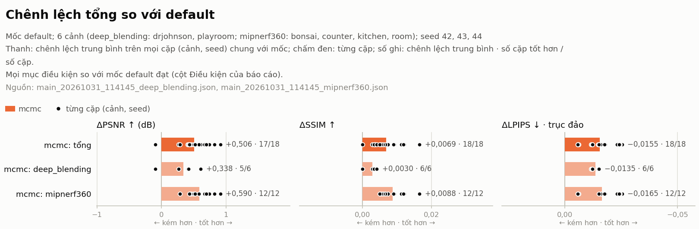
*Chênh lệch của `mcmc` so với `default`: thanh là trung bình, chấm đen là từng cặp (cảnh, seed). Nguồn: `main_20261031_114145_deep_blending.json`, `main_20261031_114145_mipnerf360.json`.*

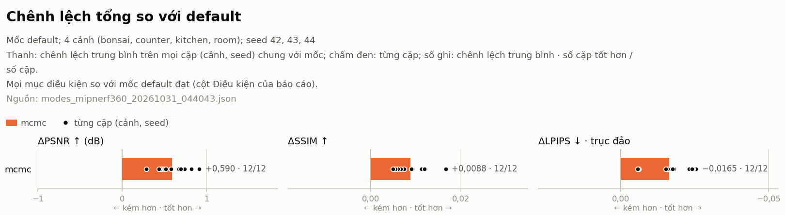
*Riêng 4 cảnh Mip-NeRF 360. Nguồn: `modes_mipnerf360_20261031_044043.json`.*

### 2.2. Theo từng cảnh

Δ = `mcmc` − `default`, trung bình 3 seed (PSNR, SSIM: dương là tốt hơn; LPIPS: âm là tốt hơn).

| Cảnh | Bộ dữ liệu | ΔPSNR (dB) | ΔSSIM | ΔLPIPS | σ PSNR `default` / `mcmc` |
|---|---|---:|---:|---:|---|
| drjohnson | Deep Blending | +0,480 | +0,0034 | −0,0120 | 0,017 / 0,096 |
| playroom | Deep Blending | +0,197 | +0,0026 | −0,0150 | 0,085 / 0,294 |
| room | Mip-NeRF 360 | +0,809 | +0,0118 | −0,0246 | 0,060 / 0,137 |
| counter | Mip-NeRF 360 | +0,544 | +0,0116 | −0,0195 | 0,193 / 0,026 |
| kitchen | Mip-NeRF 360 | +0,435 | +0,0052 | −0,0058 | 0,083 / 0,123 |
| bonsai | Mip-NeRF 360 | +0,571 | +0,0067 | −0,0158 | 0,034 / 0,082 |

- Ở `playroom`, ΔPSNR nhỏ hơn dao động giữa các seed của `mcmc`.
- Deep Blending dùng `opacity_reg` 0,001 cho `mcmc` ở cả hai cảnh (bài báo 3DGS-MCMC chỉ ghi giá trị này cho `drjohnson`).

## 3. Kiểm chứng baseline

| Phép đối chiếu | Kết quả |
|---|---|
| `default` so với số Inria công bố, Deep Blending | **PASS**: PSNR −0,168 dB, SSIM −0,002, LPIPS +0,008 (trung bình) |
| `default` so với B0 (3DGS gốc của Inria, tự chạy) | **PASS**: drjohnson −0,339 dB, playroom −0,136 dB |
| Mip-NeRF 360 so với số công bố | **SKIPPED**: mới chạy 4/9 cảnh, không so được với trung bình 9 cảnh |


*Đối chiếu `default` với B0 tự chạy (từng cảnh) và với số Inria công bố (trung bình); vùng xám là ngưỡng chấp nhận (±0,5 dB, ±0,01, ±0,01).*

## 4. Chi phí tính toán

| Hạng mục | Giá trị |
|---|---|
| Thời gian train | Khoảng 12–18 phút mỗi lượt (cảnh, seed) trong thực nghiệm chính |
| Thời gian train `mcmc` so với `default` | ×0,98–1,10 |
| VRAM đỉnh | Khoảng 3–7,5 GiB; `mcmc` thấp hơn `default` 0,1–0,9 GiB |
| Thời gian render | Khoảng 28–56 ms mỗi ảnh, **có tính cả lần gọi CUDA đầu tiên**, không quy đổi trực tiếp thành FPS |

Số Gaussian và dung lượng PLY (như nhau cho hai chế độ vì cùng số Gaussian cuối):

| Cảnh | Số Gaussian | PLY |
|---|---:|---:|
| bonsai | 1.246.905 | 281 MB |
| counter | 1.178.331 | 265 MB |
| kitchen | 1.795.468 | 404 MB |
| room | 1.565.594 | 352 MB |
| drjohnson | 3.552.082 | 799 MB |
| playroom | 2.346.733 | 528 MB |

## 5. Dò tham số `mcmc` (`tune_mcmc`)

16 biến thể của `mcmc` trên `room`, **một seed (42)**: depth loss, random background, `opacity_reg` / `scale_reg`, noise learning rate, bậc SH, bilateral grid, Kill-then-Relocate, depth prior và gói `v2`. Ngưỡng coi là khác biệt thật: d = 0,150 dB (PSNR) / 0,0012 (SSIM) / 0,0018 (LPIPS).

| Nhóm | Biến thể |
|---|---|
| Hơn `mcmc` quá ngưỡng | `rbg` (random background): PSNR 32,764, hơn `mcmc` +0,156 dB, sát ngưỡng |
| Trong mức dao động | `sr0001` (PSNR 32,646), `depth` (PSNR 32,603), `nlr1m`, `nlr250k`, `kr`, `mono`, `sr005` |
| Kém hơn quá ngưỡng | `or0005`, `or0001`, `rs30k`, `sh2`, `mo002`, `or005`, `bilagrid` (−2,476 dB), `v2` (−2,750 dB) |

- `sr0001` và `depth` có PSNR cao nhưng **chưa vượt ngưỡng**, nên chưa được coi là tốt hơn `mcmc`.
- Chỉ một seed, nên chưa đủ cơ sở kết luận chính thức; vòng ghép với seed mới đã bỏ (D25, `design/experiments.md` mục 3.6), sản phẩm giữ preset `mcmc`.
- `bilagrid` và `v2` giảm mạnh PSNR nhưng LPIPS gần như không đổi. Giả thuyết chưa kiểm: lệch màu vì ảnh test được chấm mà không đi qua bilateral grid.

**Lọc Gaussian sau khi train** (bỏ Gaussian có opacity < 0,02 hoặc trục > 0,1 × `scene_scale`), rồi chấm lại: `default` giảm 1,14 dB; `mcmc` và các biến thể giảm 2,1 đến 9,1 dB. Kết luận: không dùng bộ lọc này để làm nhẹ file cho `mcmc`.


*Từng biến thể so với `mcmc` (cùng seed 42). Báo cáo ghi điều kiện "seeds=DIFF" chưa đạt ở 16/16 cặp, nên **chưa được nói "cải thiện"**.*

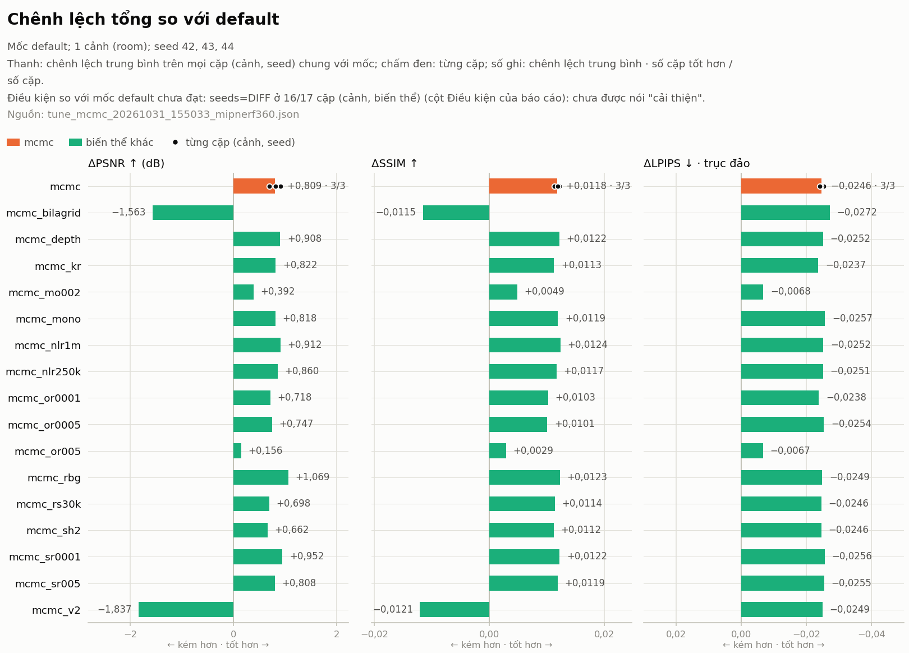
*Các biến thể so với `default` trên `room` (`mcmc` có 3 seed, các biến thể 1 seed).*

## 6. Phòng tự quay của nhóm

### 6.1. `phong_nhom` (31/10/2026)

Một video tự quay, 1 seed; ảnh test là mỗi khung thứ tám của chính video.

| Chế độ | PSNR | SSIM | LPIPS |
|---|---:|---:|---:|
| `default` | 39,318 | 0,9769 | 0,0959 |
| `mcmc` | 39,069 | 0,9788 | 0,0873 |

Hai chế độ trái chiều nhau (PSNR nghiêng về `default`; SSIM, LPIPS nghiêng về `mcmc`). Ảnh test là các khung kề khung train của cùng video, nên số này **không so được với benchmark** và cao hơn mức thật khi nhìn từ góc mới.

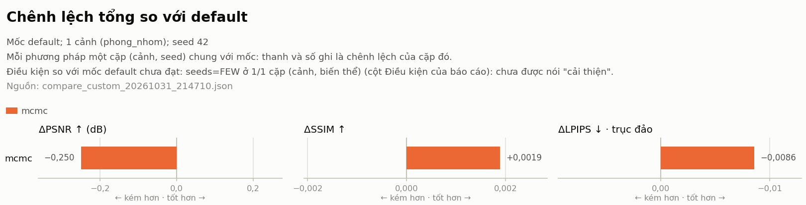
*ΔPSNR −0,250 dB, ΔSSIM +0,0019, ΔLPIPS −0,0086 (1 seed). Báo cáo ghi điều kiện "seeds=FEW" chưa đạt, nên chưa được nói "cải thiện". Nguồn: `compare_custom_20261031_214710.json`.*

### 6.2. Ba phòng tự quay, ảnh test là các đoạn liền của video (12–13/11/2026)

Kiểm lại `default`, `mcmc` và ba biến thể của `mcmc` trên phòng thật, với ảnh test cách xa ảnh train hơn mục 6.1. Thiết kế và luật đọc kết quả được ghi **trước khi chạy**: [design/experiments.md](design/experiments.md) mục 3.8 (D26).

| Hạng mục | Giá trị |
|---|---|
| Phòng | `video8` (phòng ngủ, video 1:37), `video9` (phòng học, 1:52), `video10` (phòng ký túc xá, 2:54); mô hình COLMAP của luồng sản phẩm ngày 08/11/2026 |
| Tập chia | 6 đoạn liền làm test, 30 ảnh test mỗi phòng; bỏ 3 khung mỗi bên đoạn (36 ảnh); ảnh train 184 / 157 / 183; khung test cách khung train gần nhất ít nhất 4 khung (1,4 / 1,6 / 2,3 giây) |
| Cấu hình | `default`; `mcmc` cùng số Gaussian với `default` cùng seed; ba biến thể của `mcmc` (mục 5): `rbg` (nền ngẫu nhiên), `mono` (prior độ sâu Depth Anything V2, loss Pearson), `kr` (Kill-then-Relocate) |
| Lượt | 3 phòng × 5 cấu hình × 3 seed (42, 43, 44) = **45/45 lượt OK**; mọi điều kiện so sánh đạt (cùng tập chia, commit gsplat, GPU, số Gaussian) |
| GPU, code | RTX 4090; gsplat `6e8c837`; 28 lượt ở commit `49c208b`, 17 lượt ở `52afb1d` (giữa hai commit, phần dùng khi train chỉ khác bộ kiểm NaN của hook, không đổi tham số nào) |

**Kết luận:**
- `mcmc` tốt hơn `default` ở **9/9** cặp (phòng, seed) ở cả ba chỉ số, vượt mức dao động d_r ở 8/9 ô (3 phòng × 3 chỉ số); riêng ΔPSNR của `video8` nằm trong mức dao động. Trung bình 9 cặp: PSNR **+2,182 dB**, SSIM +0,0262, LPIPS −0,0262. Ở hai phòng khó, chênh lệch lớn hơn nhiều so với benchmark (mục 2: +0,34 đến +0,59 dB).
- **Không biến thể nào đạt luật mục 3.8**; sản phẩm giữ preset `mcmc`.

Trung bình ± độ lệch chuẩn trên 3 seed:

| Phòng | Chế độ | PSNR ↑ | SSIM ↑ | LPIPS ↓ |
|---|---|---:|---:|---:|
| `video8` | `default` | 25,359 ± 0,529 | 0,9371 ± 0,0028 | 0,1421 ± 0,0019 |
| `video8` | `mcmc` | **25,698 ± 0,553** | **0,9443 ± 0,0021** | **0,1340 ± 0,0031** |
| `video9` | `default` | 18,585 ± 1,372 | 0,8639 ± 0,0153 | 0,2411 ± 0,0169 |
| `video9` | `mcmc` | **22,509 ± 0,444** | **0,8853 ± 0,0054** | **0,2038 ± 0,0039** |
| `video10` | `default` | 19,532 ± 0,199 | 0,8210 ± 0,0035 | 0,2990 ± 0,0021 |
| `video10` | `mcmc` | **21,816 ± 0,188** | **0,8709 ± 0,0009** | **0,2658 ± 0,0014** |

Δ = `mcmc` − `default`, trung bình theo cặp cùng seed; nhãn so với mức dao động của phòng, d_r = √2 · √((σ²<sub>default</sub> + σ²<sub>mcmc</sub>) / 2), chỉ tính từ 6 lượt `default`, `mcmc` của phòng đó:

| Phòng | ΔPSNR (dB) · cặp tốt hơn | ΔSSIM · cặp | ΔLPIPS · cặp | d_r (PSNR / SSIM / LPIPS) |
|---|---|---|---|---|
| `video8` | +0,339 · 3/3 (dao động) | +0,0072 · 3/3 (tốt hơn) | −0,0080 · 3/3 (tốt hơn) | 0,765 / 0,0035 / 0,0036 |
| `video9` | +3,923 · 3/3 (tốt hơn) | +0,0214 · 3/3 (tốt hơn) | −0,0373 · 3/3 (tốt hơn) | 1,442 / 0,0162 / 0,0173 |
| `video10` | +2,285 · 3/3 (tốt hơn) | +0,0499 · 3/3 (tốt hơn) | −0,0332 · 3/3 (tốt hơn) | 0,274 / 0,0036 / 0,0025 |

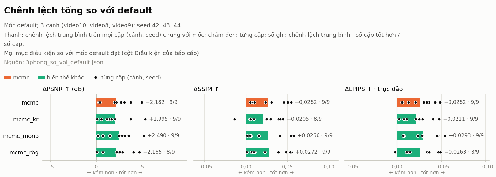
*Chênh lệch so với `default` trên 9 cặp (phòng, seed): thanh là trung bình, chấm đen là từng cặp. Nguồn: `rooms_vs_default.md`.*

**Ba biến thể so với `mcmc`.** Luật mục 3.8: biến thể là cải thiện khi mọi điều kiện so sánh đạt, tốt hơn `mcmc` quá d_r ở ít nhất 2 trong 3 phòng ở ít nhất một chỉ số, và không phòng nào kém quá d_r ở chỉ số nào.

| Phòng | Biến thể | ΔPSNR (dB) | ΔSSIM | ΔLPIPS | Cặp tốt hơn (PSNR · SSIM · LPIPS) |
|---|---|---|---|---|---|
| `video8` | `rbg` | −0,094 (dao động) | −0,0012 (dao động) | +0,0010 (dao động) | 1/3 · 1/3 · 2/3 |
| `video8` | `mono` | +0,457 (dao động) | −0,0031 (dao động) | +0,0009 (dao động) | 2/3 · 1/3 · 2/3 |
| `video8` | `kr` | +0,246 (dao động) | −0,0007 (dao động) | −0,0006 (dao động) | 2/3 · 2/3 · 2/3 |
| `video9` | `rbg` | −0,067 (dao động) | +0,0021 (dao động) | +0,0009 (dao động) | 1/3 · 1/3 · 1/3 |
| `video9` | `mono` | −0,084 (dao động) | −0,0009 (dao động) | −0,0032 (dao động) | 1/3 · 1/3 · 2/3 |
| `video9` | `kr` | −0,347 (dao động) | −0,0079 (dao động) | +0,0074 (dao động) | 1/3 · 1/3 · 0/3 |
| `video10` | `rbg` | +0,111 (dao động) | +0,0021 (dao động) | −0,0022 (dao động) | 2/3 · 3/3 · 3/3 |
| `video10` | `mono` | +0,549 (tốt hơn) | +0,0052 (tốt hơn) | −0,0069 (tốt hơn) | 2/3 · 2/3 · 2/3 |
| `video10` | `kr` | −0,460 (**kém**) | −0,0084 (**kém**) | +0,0083 (**kém**) | 0/3 · 0/3 · 0/3 |

| Biến thể | Phòng tốt hơn quá d_r | Phòng kém quá d_r | Kết luận theo luật |
|---|---|---|---|
| `rbg` | không | không | **KHÔNG ĐẠT** |
| `mono` | `video10` (PSNR, SSIM, LPIPS) | không | **KHÔNG ĐẠT** (cần 2 phòng) |
| `kr` | không | `video10` (PSNR, SSIM, LPIPS) | **KHÔNG ĐẠT** |


*Chênh lệch của từng biến thể so với `mcmc` trên 9 cặp (phòng, seed). Nguồn: `rooms_vs_mcmc.md`.*

- `mono` tốt hơn quá d_r ở `video10` (cả ba chỉ số), trong mức dao động ở `video8` (PSNR +0,457 dB nhưng SSIM −0,0031) và `video9`; trung bình 9 cặp PSNR +0,307 dB (5/9 cặp tốt hơn). Có xu hướng tốt nhưng mới đạt ở 1 phòng, chưa đủ để gọi là cải thiện.
- `kr` kém quá d_r ở `video10` ở cả ba chỉ số. `kr` giảm tỉ lệ Gaussian rất to (trục lớn nhất > 0,1 × `scene_scale`: 0,25–0,55 %, so với 0,59–0,91 % của `mcmc`), nhưng điều đó không làm ảnh test tốt hơn.
- `rbg`, ứng viên duy nhất của lượt dò trên `room` (mục 5), nằm trong mức dao động ở cả ba phòng.
- d_r của `video9` lớn (PSNR 1,442 dB) vì chính `default` dao động mạnh giữa các seed (σ 1,372 dB; ví dụ ở ảnh test 29, `default` seed 42 có một lớp mờ trắng phủ trước camera), nên ở phòng này biến thể khó vượt ngưỡng hơn. Đây là luật đã ghi trước khi chạy, không chỉnh sau khi có số.

**Chi phí tính toán** (trung bình 3 seed; thời gian train của bước train, không gồm bước chấm):

| Phòng | Số Gaussian (TB 3 seed) | PLY | Train `default` / `mcmc` / `rbg` / `kr` / `mono` (phút) | VRAM đỉnh |
|---|---:|---:|---|---|
| `video8` | 755.431 | 170 MB | 7,4 / 8,3 / 8,5 / 8,3 / 14,6 | 2,0–2,1 GiB |
| `video9` | 829.515 | 187 MB | 6,8 / 7,1 / 7,4 / 7,3 / 12,6 | 2,1–2,2 GiB |
| `video10` | 3.625.797 | 816 MB | 17,1 / 18,2 / 18,3 / 18,1 / 21,8 | 6,7–7,5 GiB |

- `mono` train lâu hơn `mcmc` ×1,76 (`video8`), ×1,77 (`video9`), ×1,20 (`video10`), chưa kể bước tính prior độ sâu (bảng dưới; chạy một lần cho mỗi phòng, các lượt sau dùng lại). Các biến thể khác ×0,99–1,05.
- `default` của `video10` tự tăng tới khoảng 3,6 triệu Gaussian, nên `mcmc` và các biến thể ở phòng này cũng chạy với ngân sách đó; sản phẩm dùng `cap_max` 1 triệu (mục 7), chưa kiểm ở mức đó.
- Cả 45 lượt: 9,1 giờ train (chưa kể bước chấm); PLY cộng checkpoint 34 GB trên volume (mỗi lượt khoảng 0,34 / 0,37 / 1,6 GB ở `video8` / `video9` / `video10`).

| Phòng | Ảnh train dùng prior | Tương quan trung vị với điểm SfM | Thời gian tính prior (lần đầu) |
|---|---:|---:|---|
| `video8` | 184/184 | 0,931 | 39 giây |
| `video9` | 145/157 | 0,850 | tính ở lượt bị dừng (bên dưới), các lượt chạy lại dùng lại |
| `video10` | 181/183 | 0,969 | 37 giây |

**Sự cố khi chạy:**
- `video9`: 6 lượt `mono`, `kr` đầu tiên dừng ở vòng 0 vì bộ kiểm NaN của hook coi 157 Gaussian kích thước 0 lúc khởi tạo (điểm SfM trùng vị trí) là lỗi. Đã sửa (commit `4251ff2`) và chạy lại; nhật ký hook của các lượt chạy lại ghi `zero_size: 157` ở vòng 0 và 500, về 0 từ vòng 1.000 (seed 44: từ vòng 1.500); `video8` và `video10` không có Gaussian như vậy. Chi tiết: [design/experiments.md](design/experiments.md) cuối mục 3.8.
- Pod khởi động lại một lần (Edit Pod, 12/11/2026) khi `video10` đang chạy: lượt dở được chạy lại từ đầu, các lượt đã xong giữ nguyên.

**Giới hạn:** ảnh test vẫn nằm trên đường đã quay (các đoạn liền của chính video), chưa phải góc nhìn độc lập; ba phòng, một loại GPU, 3 seed; ngân sách Gaussian bằng `default` (0,76 / 0,83 / 3,63 triệu), khác `cap_max` 1 triệu của sản phẩm.

## 7. Sản phẩm chạy trên pod (08/11/2026)

Lần đầu chạy trọn luồng sản phẩm trên GPU: tải video lên trang web → pod chạy `scripts/build_room.sh` với mô hình chính `mcmc` → xem 3D trên trình duyệt. Số liệu lấy từ trang Tổng quan của web.

| Hạng mục | Giá trị |
|---|---|
| Phòng | `video10` |
| Đầu vào | Một video dài 2 phút 54 giây |
| Ảnh COLMAP định vị được | 249 |
| Số Gaussian | 637.031 |
| File xem web (`model.splat`) | 20,4 MB |
| Thời gian train | 8 phút 23 giây |
| GPU | NVIDIA GeForce RTX 4090 |
| Trạng thái | Hoàn thành, mở được trong trình xem 3D |


Video demo (quay màn hình, 11 phút, ngày 08/11/2026): [xem trên Google Drive](https://drive.google.com/file/d/1FG4LS7gpBTIIer8L2jTSQQHPk12BszV4/view); file không đưa lên Git.

**Thời gian từng bước.** Số đọc từ trang Tiến độ trong video demo ở trên: phòng `1`, dựng lại từ cùng video 2 phút 54 giây với `video10`, gửi lúc 22:30, xong lúc 22:48.

| Bước | Thời gian |
|---|---|
| Tách khung ảnh từ video (250 khung) | 12 giây |
| COLMAP: ước lượng camera (249/250 ảnh định vị, kiểm tra Đạt) | 9 phút 40 giây |
| Train mô hình chính `mcmc` | 8 phút 32 giây (riêng vòng huấn luyện: 8 phút 15 giây) |
| Xuất mô hình web, thêm vào thư viện | 18 giây |
| **Tổng** (trang Tiến độ ghi; bốn bước cộng lại 18 phút 42 giây) | **18 phút 45 giây** |

Kết quả: 642.142 Gaussian, `model.splat` 20,5 MB (20.548.544 byte). Hai lượt trên cùng video cho số Gaussian lệch 0,8 % (637.031 và 642.142).

**Xem trên laptop** (nút "Đo trên máy này" của trang Xem 3D: 10 giây tự xoay quanh, chất lượng Cao, độ phân giải 100%). Đo một lần, **trong lúc đang quay màn hình demo** (kết quả hiện trong video ở phút 9:05): phần mềm quay màn hình dùng chung GPU tích hợp, nên FPS này có thể thấp hơn khi xem bình thường.

| Hạng mục | Giá trị |
|---|---|
| Máy xem | Laptop Windows, Chrome 157, GPU tích hợp Intel UHD Graphics; khung vẽ 1440 × 845, tỉ lệ điểm ảnh 1,25 |
| Tải `model.splat` (20,5 MB) | 956 ms |
| Giải mã | 195 ms |
| Khung hình đầu tiên | 1.152 ms |
| FPS | trung bình 10,5; thấp nhất 9,3 |

- Cả ba chế độ xem (xoay quanh, đi bộ, tham quan theo đường quay) chạy được. Khi đi bộ ra xa đường đã quay (sát tường, góc chưa quay tới) thấy vệt nhòe và floater; đi theo đường quay thì ảnh rõ.
- FPS mới đo một lần trên GPU tích hợp, trong lúc đang quay màn hình. Chưa đo khi không quay màn hình, ở các mức chất lượng Vừa / Nhẹ, trên GPU rời hay điện thoại.

**Thư viện sau ngày 08/11/2026** (trang Tổng quan): 7 phòng dựng xong, 2 dự án dừng ở bước COLMAP (kiểm tra đầu vào báo FAIL nên không train).

| Phòng | Video | Gaussian trong `model.splat` |
|---|---|---:|
| `t` | 1:36 | 432.587 |
| `video2` | 0:31 | 820.162 |
| `video8` | 1:37 | 676.198 |
| `video9` | 1:52 | 429.896 |
| `1789028710123_…` | 0:13 | 470.618 |
| `video10` | 2:54 | 637.031 |
| `1` | 2:54 | 642.142 |

Cần kiểm tra thêm: mọi phòng đều có ít hơn `cap_max` 1.000.000 Gaussian của `configs/product.yaml`. Đây là số Gaussian trong `model.splat`. Giả thuyết chưa kiểm: train đủ 1.000.000, bước xuất bỏ các Gaussian trong suốt hoàn toàn; kiểm bằng `num_gaussians_trained` trong `manifest.json` của web (`PROJECT_STATUS.md` mục "Còn mở").

## 8. Môi trường

| Hạng mục | Giá trị |
|---|---|
| GPU | NVIDIA GeForce RTX 4090 (dung lượng VRAM: xem `docs/ENVIRONMENT_AUDIT.md` mục 7) |
| CUDA, PyTorch | CUDA toolkit 12.8; PyTorch 2.7.1 + CUDA 12.8 |
| Hệ điều hành, Python | Ubuntu 22.04.5; Python 3.10 |
| Phiên bản ghim | gsplat commit `6e8c837`; 3DGS Inria commit `54c035f` |

## 9. Lựa chọn rút ra và giới hạn

- `mcmc` được chọn làm **mô hình chính của sản phẩm** (`configs/product.yaml`). Lựa chọn này, việc không xét gói `v2` như một ứng viên và việc bỏ vòng ghép (D25) được chốt **sau khi đã có kết quả**; báo cáo phải ghi rõ.
- Trên ba phòng tự quay (mục 6.2), `mcmc` tốt hơn `default` ở cả 9/9 cặp (phòng, seed) và cả ba chỉ số, chênh lệch lớn hơn benchmark ở phòng khó: thêm căn cứ cho lựa chọn trên, lần này trên đúng loại dữ liệu của sản phẩm (video điện thoại).
- Ba biến thể `rbg`, `mono`, `kr` **không đạt** luật ghi trước khi chạy (mục 6.2): kết quả âm được báo cáo đầy đủ, sản phẩm giữ `mcmc`. `mono` có xu hướng tốt (đạt ở `video10`), cần thêm phòng mới kết luận được.
- Đóng góp là **tích hợp và đánh giá các kỹ thuật có sẵn** cộng một heuristic, không phải thuật toán mới.
- Chưa có: FPS trên GPU rời và điện thoại (mới đo trên GPU tích hợp: 10,5 FPS), điểm đánh giá cho phòng tự dựng từ góc nhìn mới, 5/9 cảnh còn lại của Mip-NeRF 360. Danh sách đầy đủ: [PROJECT_STATUS.md](PROJECT_STATUS.md) mục "Còn mở".

## 10. Ảnh so sánh từng ảnh test

Mỗi ảnh gồm ba hàng: ảnh thật, `default` (seed 42), `mcmc` (seed 42); cột giữa là vùng phóng to (khung đỏ), cột phải là sai số tuyệt đối ×4 (càng sáng càng sai). PSNR ghi trên ảnh là của **riêng ảnh đó**, có thể khác chiều với kết quả trung bình ở mục 2.

| Ảnh | Cảnh | PSNR `default` | PSNR `mcmc` |
|---|---|---:|---:|
| [room_test00](results/panels/room_test00.jpg) | Mip-NeRF 360 `room`, ảnh test 0 | 30,81 | **31,50** |
| [room_test19](results/panels/room_test19.jpg) | Mip-NeRF 360 `room`, ảnh test 19 | 29,98 | **31,18** |
| [room_test38](results/panels/room_test38.jpg) | Mip-NeRF 360 `room`, ảnh test 38 | 31,18 | **32,32** |
| [playroom_test00](results/panels/playroom_test00.jpg) | Deep Blending `playroom`, ảnh test 0 | **30,22** | 30,05 |
| [playroom_test14](results/panels/playroom_test14.jpg) | Deep Blending `playroom`, ảnh test 14 | **27,45** | 27,00 |
| [playroom_test28](results/panels/playroom_test28.jpg) | Deep Blending `playroom`, ảnh test 28 (cầu thang) | **33,40** | 32,62 |
| [phong_nhom_test00](results/panels/phong_nhom_test00.jpg) | Phòng của nhóm, ảnh test 0 | **37,72** | 36,56 |
| [phong_nhom_test16](results/panels/phong_nhom_test16.jpg) | Phòng của nhóm, ảnh test 16 | **39,13** | 38,42 |
| [phong_nhom_test31](results/panels/phong_nhom_test31.jpg) | Phòng của nhóm, ảnh test 31 | **37,69** | 36,35 |

- Ở `room`, `mcmc` hơn rõ trên cả ba ảnh (+0,69 đến +1,20 dB), khớp với ΔPSNR +0,809 dB của cảnh này.
- Ở `playroom` (cả 3 ảnh) và phòng của nhóm, `default` hơn trên các ảnh được chọn. Với `playroom`, điều này phù hợp với ΔPSNR nhỏ và dao động lớn giữa các seed (mục 2.2); với phòng của nhóm, phù hợp với ΔPSNR −0,250 dB (mục 6).

### Mip-NeRF 360 `room`

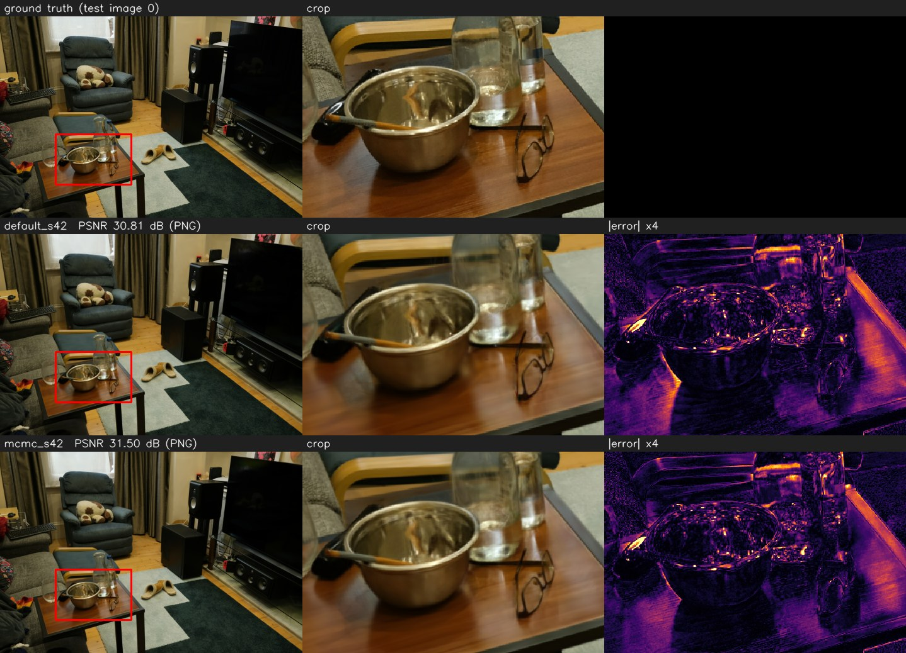
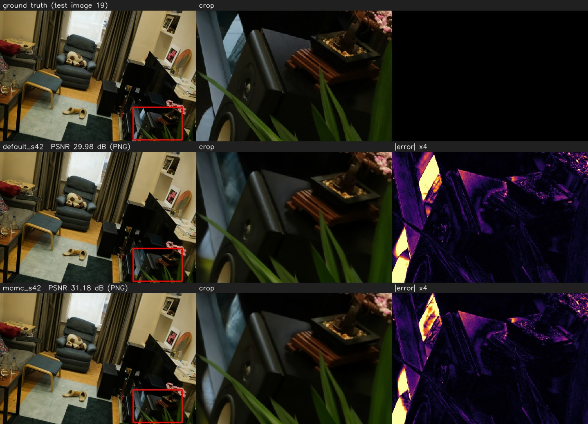
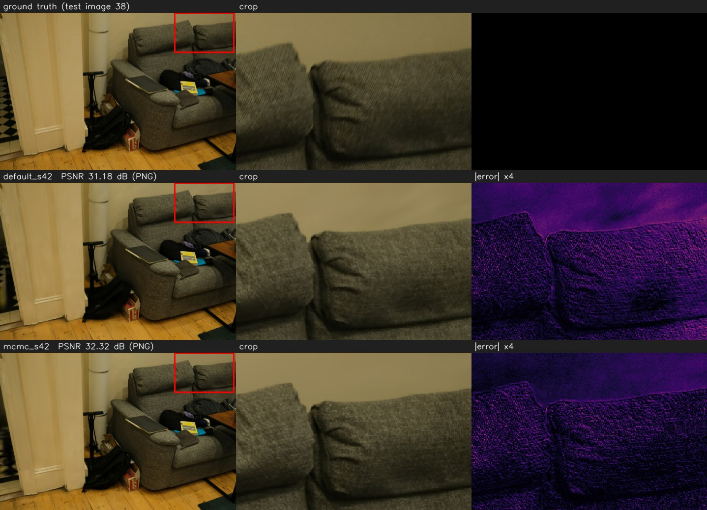

### Deep Blending

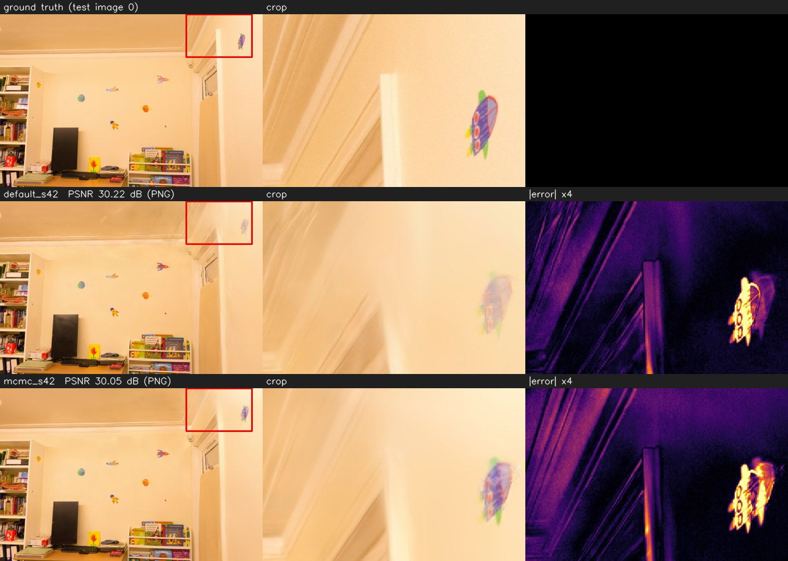
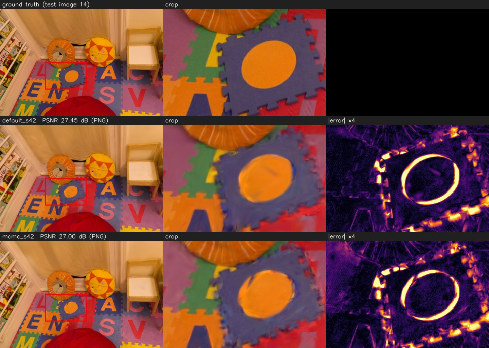
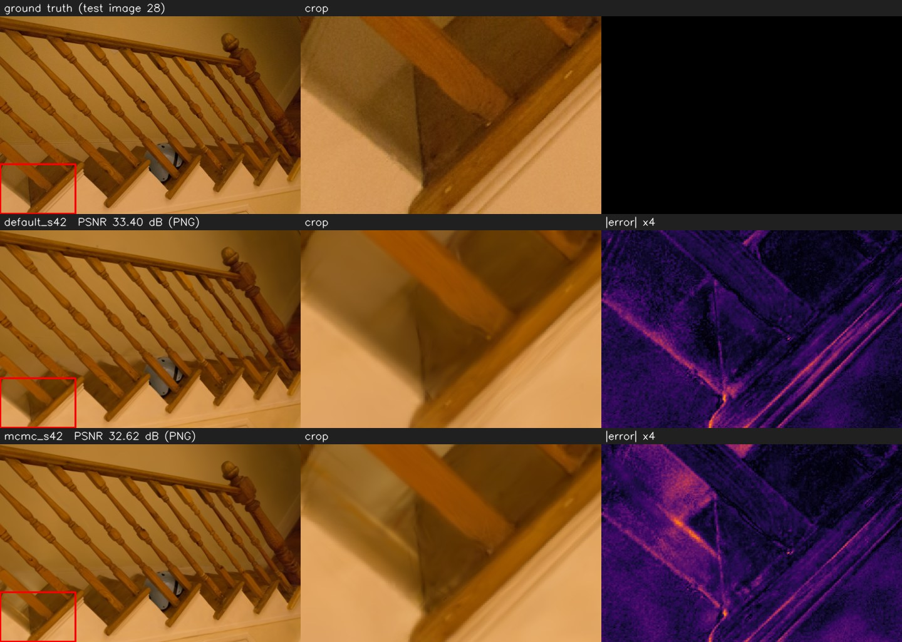

### Phòng của nhóm (`phong_nhom`)

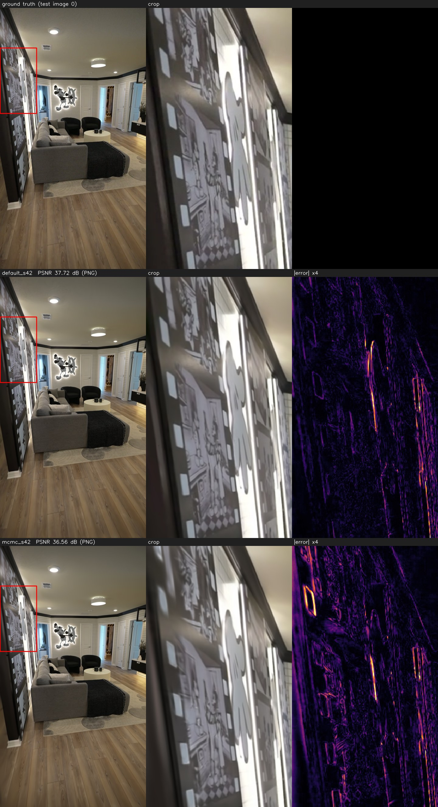
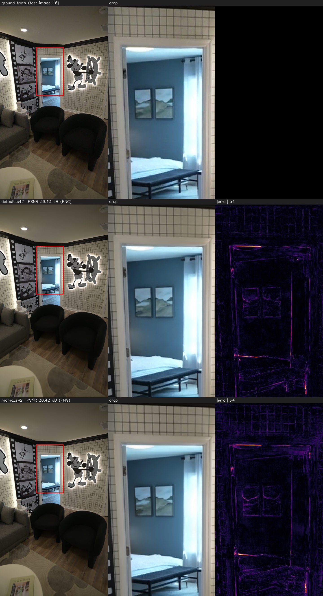
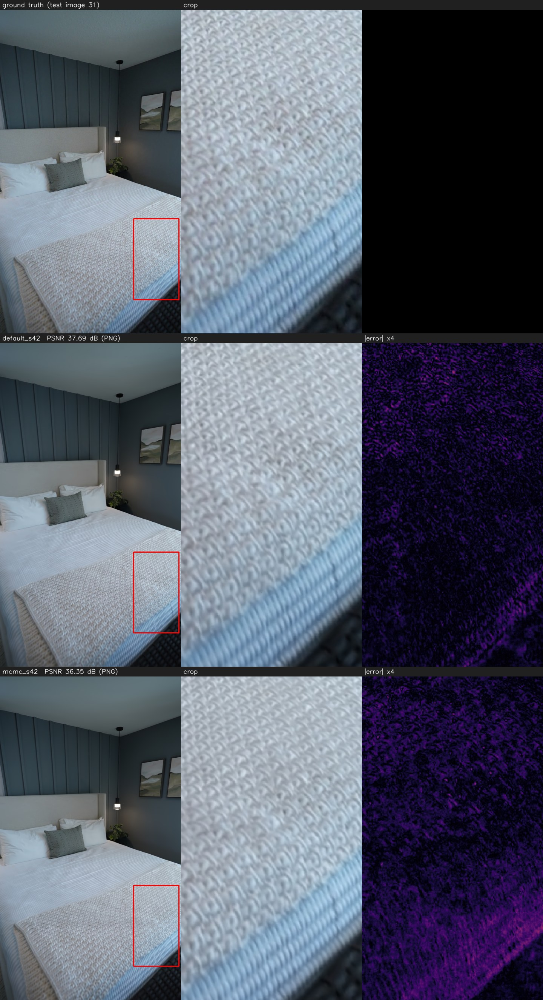

## 11. File báo cáo gốc

Lượt ngày 12–13/11/2026 (mục 6.2): các báo cáo chính đã chép vào [results/segment_eval/](results/segment_eval/): `rule_3_8.md` / `.json` (đủ lượt, d_r, kết luận theo luật; `python -m src.evaluation.segment_rule`), `rooms_vs_default.md`, `rooms_vs_mcmc.md` (bảng của `src.evaluation.compare_modes`, kèm biểu đồ). Tên gốc trên volume: `luat_3_8.*`, `3phong_so_voi_default.*`, `3phong_so_voi_mcmc.*`. Bảng từng phòng, ảnh so sánh gốc (PNG) và log nằm trong gói `ket_qua_danh_gia_theo_doan_day_du_20261112_180406.tar.gz`.

Lượt ngày 31/10/2026: các báo cáo `.md` / `.json` vẫn nằm trên volume. Nếu cần lưu cả vào repo, chạy trên pod (trong `/workspace/SpatialRoom3D`):

```bash
cp /workspace/outputs/reports/main_20261031_114145.md \
   /workspace/outputs/reports/tune_mcmc_20261031_155033.md \
   /workspace/outputs/reports/compare_custom_20261031_214710.md docs/results/
```
