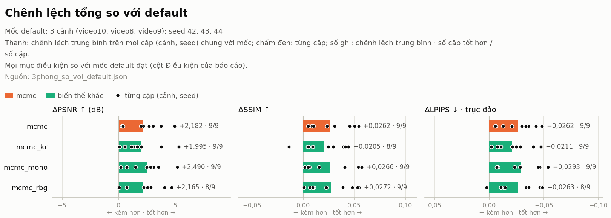

Baseline: `default<test-list>`. Số liệu là trung bình ± độ lệch chuẩn theo seed (n = số lượt chạy).

| Cảnh | Biến thể | n | PSNR ↑ | SSIM ↑ | LPIPS ↓ | Số Gaussian | Train (phút) | VRAM đỉnh (GiB) | Render (ms/ảnh) | PLY (MB) |
|---|---|---|---|---|---|---|---|---|---|---|
| video10 | default<test-list> | 3 | 19.532 ± 0.199 | 0.8210 ± 0.0035 | 0.2990 ± 0.0021 | 3,625,797 | 17.1 | 7.5 | 106.56 | 816 |
| video10 | mcmc<test-list> | 3 | 21.816 ± 0.188 | 0.8709 ± 0.0009 | 0.2658 ± 0.0014 | 3,625,797 | 18.2 | 6.7 | 93.21 | 816 |
| video10 | mcmc[random-bkgd=True]<test-list> | 3 | 21.928 ± 0.241 | 0.8730 ± 0.0008 | 0.2637 ± 0.0008 | 3,625,797 | 18.3 | 6.7 | 146.28 | 816 |
| video10 | mcmc[sr3d.kr=True]<test-list> | 3 | 21.356 ± 0.296 | 0.8625 ± 0.0012 | 0.2741 ± 0.0024 | 3,625,797 | 18.1 | 6.8 | 100.54 | 816 |
| video10 | mcmc[sr3d.mono=True]<test-list> | 3 | 22.365 ± 0.515 | 0.8761 ± 0.0040 | 0.2589 ± 0.0081 | 3,625,797 | 21.8 | 6.7 | 122.00 | 816 |
| video8 | default<test-list> | 3 | 25.359 ± 0.529 | 0.9371 ± 0.0028 | 0.1421 ± 0.0019 | 755,431 | 7.4 | 2.1 | 187.61 | 170 |
| video8 | mcmc<test-list> | 3 | 25.698 ± 0.553 | 0.9443 ± 0.0021 | 0.1340 ± 0.0031 | 755,431 | 8.3 | 2.1 | 168.62 | 170 |
| video8 | mcmc[random-bkgd=True]<test-list> | 3 | 25.604 ± 0.320 | 0.9431 ± 0.0030 | 0.1350 ± 0.0065 | 755,431 | 8.5 | 2.1 | 179.63 | 170 |
| video8 | mcmc[sr3d.kr=True]<test-list> | 3 | 25.944 ± 0.133 | 0.9436 ± 0.0006 | 0.1334 ± 0.0013 | 755,431 | 8.3 | 2.0 | 105.90 | 170 |
| video8 | mcmc[sr3d.mono=True]<test-list> | 3 | 26.155 ± 0.200 | 0.9413 ± 0.0023 | 0.1350 ± 0.0017 | 755,431 | 14.6 | 2.1 | 167.53 | 170 |
| video9 | default<test-list> | 3 | 18.585 ± 1.372 | 0.8639 ± 0.0153 | 0.2411 ± 0.0169 | 829,515 | 6.8 | 2.2 | 63.22 | 187 |
| video9 | mcmc<test-list> | 3 | 22.509 ± 0.444 | 0.8853 ± 0.0054 | 0.2038 ± 0.0039 | 829,515 | 7.1 | 2.1 | 72.76 | 187 |
| video9 | mcmc[random-bkgd=True]<test-list> | 3 | 22.441 ± 0.499 | 0.8874 ± 0.0009 | 0.2047 ± 0.0025 | 829,515 | 7.4 | 2.2 | 89.44 | 187 |
| video9 | mcmc[sr3d.kr=True]<test-list> | 3 | 22.162 ± 0.494 | 0.8774 ± 0.0121 | 0.2112 ± 0.0083 | 829,515 | 7.3 | 2.2 | 112.07 | 187 |
| video9 | mcmc[sr3d.mono=True]<test-list> | 3 | 22.425 ± 0.315 | 0.8844 ± 0.0047 | 0.2005 ± 0.0045 | 829,515 | 12.6 | 2.1 | 82.44 | 187 |

`Render (ms/ảnh)` ở mọi bảng: thời gian gsplat đo khi chấm ảnh test, trong tiến trình chấm riêng, gồm cả lần gọi đầu (nạp CUDA). Không phải tốc độ render của mô hình; không đổi ra FPS.

Chênh lệch so với `default<test-list>`, tính trên các seed chung (dương ở PSNR/SSIM và âm ở LPIPS là tốt hơn):

| Cảnh | Biến thể | Seed | ΔPSNR | ΔSSIM | ΔLPIPS | Tỉ lệ số Gaussian | Tỉ lệ thời gian | Điều kiện |
|---|---|---|---|---|---|---|---|---|
| video10 | mcmc<test-list> | 42,43,44 | +2.285 | +0.0499 | -0.0332 | 1.000 | 1.07 | đủ điều kiện |
| video10 | mcmc[random-bkgd=True]<test-list> | 42,43,44 | +2.396 | +0.0520 | -0.0354 | 1.000 | 1.07 | đủ điều kiện |
| video10 | mcmc[sr3d.kr=True]<test-list> | 42,43,44 | +1.824 | +0.0416 | -0.0249 | 1.000 | 1.06 | đủ điều kiện |
| video10 | mcmc[sr3d.mono=True]<test-list> | 42,43,44 | +2.834 | +0.0551 | -0.0401 | 1.000 | 1.28 | đủ điều kiện |
| video8 | mcmc<test-list> | 42,43,44 | +0.339 | +0.0072 | -0.0080 | 1.000 | 1.12 | đủ điều kiện |
| video8 | mcmc[random-bkgd=True]<test-list> | 42,43,44 | +0.245 | +0.0060 | -0.0071 | 1.000 | 1.14 | đủ điều kiện |
| video8 | mcmc[sr3d.kr=True]<test-list> | 42,43,44 | +0.585 | +0.0065 | -0.0086 | 1.000 | 1.11 | đủ điều kiện |
| video8 | mcmc[sr3d.mono=True]<test-list> | 42,43,44 | +0.796 | +0.0041 | -0.0071 | 1.000 | 1.96 | đủ điều kiện |
| video9 | mcmc<test-list> | 42,43,44 | +3.923 | +0.0214 | -0.0373 | 1.000 | 1.04 | đủ điều kiện |
| video9 | mcmc[random-bkgd=True]<test-list> | 42,43,44 | +3.856 | +0.0235 | -0.0364 | 1.000 | 1.09 | đủ điều kiện |
| video9 | mcmc[sr3d.kr=True]<test-list> | 42,43,44 | +3.577 | +0.0135 | -0.0299 | 1.000 | 1.07 | đủ điều kiện |
| video9 | mcmc[sr3d.mono=True]<test-list> | 42,43,44 | +3.840 | +0.0205 | -0.0406 | 1.000 | 1.85 | đủ điều kiện |

Trung bình trên các cảnh có đủ mọi biến thể (chỉ các seed chung của cảnh): video10 (seed 42,43,44), video8 (seed 42,43,44), video9 (seed 42,43,44)

- `default<test-list>`: PSNR 21.159, SSIM 0.874, LPIPS 0.227
- `mcmc<test-list>`: PSNR 23.341, SSIM 0.900, LPIPS 0.201
- `mcmc[random-bkgd=True]<test-list>`: PSNR 23.324, SSIM 0.901, LPIPS 0.201
- `mcmc[sr3d.kr=True]<test-list>`: PSNR 23.154, SSIM 0.894, LPIPS 0.206
- `mcmc[sr3d.mono=True]<test-list>`: PSNR 23.648, SSIM 0.901, LPIPS 0.198

Số cặp (cảnh, seed) và số cảnh tốt hơn `default<test-list>` (PSNR / SSIM cao hơn, LPIPS thấp hơn; bằng nhau không tính). Cặp: cùng cảnh, cùng seed. Cảnh: chênh lệch trung bình trên các seed chung của cảnh, như bảng chênh lệch ở trên. Δ: trung bình ± độ lệch chuẩn theo cặp. Đọc cùng độ lệch chuẩn và cột điều kiện: nhiều cặp tốt hơn với chênh lệch nhỏ hơn độ lệch chuẩn chưa phải "cải thiện".

| Biến thể | Cặp tốt hơn: PSNR · SSIM · LPIPS | Cảnh tốt hơn: PSNR · SSIM · LPIPS | ΔPSNR | ΔSSIM | ΔLPIPS | Điều kiện |
|---|---|---|---|---|---|---|
| mcmc<test-list> | 9/9 · 9/9 · 9/9 | 3/3 · 3/3 · 3/3 | +2.182 ± 1.637 | +0.0262 ± 0.0197 | -0.0262 ± 0.0158 | đủ điều kiện |
| mcmc[random-bkgd=True]<test-list> | 8/9 · 9/9 · 8/9 | 3/3 · 3/3 · 3/3 | +2.165 ± 1.654 | +0.0272 ± 0.0216 | -0.0263 ± 0.0178 | đủ điều kiện |
| mcmc[sr3d.kr=True]<test-list> | 9/9 · 8/9 · 9/9 | 3/3 · 3/3 · 3/3 | +1.995 ± 1.626 | +0.0205 ± 0.0202 | -0.0211 ± 0.0157 | đủ điều kiện |
| mcmc[sr3d.mono=True]<test-list> | 9/9 · 9/9 · 9/9 | 3/3 · 3/3 · 3/3 | +2.490 ± 1.516 | +0.0266 ± 0.0244 | -0.0293 ± 0.0191 | đủ điều kiện |

Chất lượng theo dung lượng: mỗi bản của mô hình trong từng cảnh (gồm bản đã lọc), xếp theo dung lượng PLY; mọi dòng của một cảnh tính trên cùng các seed chung (cột Seed). Bản đã lọc chỉ có khi mọi lượt trên các seed đó đã lọc xong. Không bị vượt: ✓ khi không có bản nào nhẹ hơn hoặc bằng mà PSNR và LPIPS đều tốt hơn hoặc bằng (hơn hẳn ở ít nhất một mục); - khi dòng thiếu dung lượng hoặc chỉ số.

| Cảnh | Bản | Seed | PLY (MB) | Byte/Gaussian | Số Gaussian | PSNR ↑ | SSIM ↑ | LPIPS ↓ | Không bị vượt |
|---|---|---|---|---|---|---|---|---|---|
| video10 | default<test-list> | 42,43,44 | 816 | 236 | 3,625,797 | 19.532 | 0.8210 | 0.2990 |  |
| video10 | mcmc<test-list> | 42,43,44 | 816 | 236 | 3,625,797 | 21.816 | 0.8709 | 0.2658 |  |
| video10 | mcmc[random-bkgd=True]<test-list> | 42,43,44 | 816 | 236 | 3,625,797 | 21.928 | 0.8730 | 0.2637 |  |
| video10 | mcmc[sr3d.kr=True]<test-list> | 42,43,44 | 816 | 236 | 3,625,797 | 21.356 | 0.8625 | 0.2741 |  |
| video10 | mcmc[sr3d.mono=True]<test-list> | 42,43,44 | 816 | 236 | 3,625,797 | 22.365 | 0.8761 | 0.2589 | ✓ |
| video8 | default<test-list> | 42,43,44 | 170 | 236 | 755,431 | 25.359 | 0.9371 | 0.1421 |  |
| video8 | mcmc<test-list> | 42,43,44 | 170 | 236 | 755,431 | 25.698 | 0.9443 | 0.1340 |  |
| video8 | mcmc[random-bkgd=True]<test-list> | 42,43,44 | 170 | 236 | 755,431 | 25.604 | 0.9431 | 0.1350 |  |
| video8 | mcmc[sr3d.kr=True]<test-list> | 42,43,44 | 170 | 236 | 755,431 | 25.944 | 0.9436 | 0.1334 | ✓ |
| video8 | mcmc[sr3d.mono=True]<test-list> | 42,43,44 | 170 | 236 | 755,431 | 26.155 | 0.9413 | 0.1350 | ✓ |
| video9 | default<test-list> | 42,43,44 | 187 | 236 | 829,515 | 18.585 | 0.8639 | 0.2411 | ✓ |
| video9 | mcmc<test-list> | 42,43,44 | 187 | 236 | 829,515 | 22.509 | 0.8853 | 0.2038 | ✓ |
| video9 | mcmc[random-bkgd=True]<test-list> | 42,43,44 | 187 | 236 | 829,515 | 22.441 | 0.8874 | 0.2047 |  |
| video9 | mcmc[sr3d.kr=True]<test-list> | 42,43,44 | 187 | 236 | 829,515 | 22.162 | 0.8774 | 0.2112 |  |
| video9 | mcmc[sr3d.mono=True]<test-list> | 42,43,44 | 187 | 236 | 829,515 | 22.425 | 0.8844 | 0.2005 | ✓ |

Cấu trúc mô hình, đọc từ PLY cuối (src.evaluation.splat_stats), trung bình trên các seed mà mọi biến thể có thống kê của cảnh đều có (cột Seed). Đây là thước đo gián tiếp: Gaussian gần trong suốt hay rất to chưa chắc là floater; floater thật xem ở ảnh so sánh và video độ sâu (scripts/run_panels.sh).

| Cảnh | Biến thể | Seed | Bậc SH | opacity < 0,005 | opacity < 0,02 | opacity < 0,1 | opacity trung vị | trục lớn nhất > 0,1 × scene_scale | trục lớn nhất trung vị (× scene_scale) |
|---|---|---|---|---|---|---|---|---|---|
| video10 | default<test-list> | 42,43,44 | 3 | 21.1% | 38.0% | 59.7% | 0.047 | 0.04% | 0.0048 |
| video10 | mcmc<test-list> | 42,43,44 | 3 | 54.3% | 70.5% | 93.3% | 0.003 | 0.77% | 0.0039 |
| video10 | mcmc[random-bkgd=True]<test-list> | 42,43,44 | 3 | 54.8% | 70.9% | 93.5% | 0.003 | 0.71% | 0.0039 |
| video10 | mcmc[sr3d.kr=True]<test-list> | 42,43,44 | 3 | 54.3% | 70.4% | 93.2% | 0.003 | 0.55% | 0.0039 |
| video10 | mcmc[sr3d.mono=True]<test-list> | 42,43,44 | 3 | 53.5% | 69.8% | 93.1% | 0.004 | 0.74% | 0.0040 |
| video8 | default<test-list> | 42,43,44 | 3 | 14.9% | 28.1% | 48.4% | 0.114 | 0.03% | 0.0048 |
| video8 | mcmc<test-list> | 42,43,44 | 3 | 30.1% | 46.6% | 86.3% | 0.024 | 0.59% | 0.0046 |
| video8 | mcmc[random-bkgd=True]<test-list> | 42,43,44 | 3 | 31.0% | 47.7% | 87.0% | 0.022 | 0.73% | 0.0046 |
| video8 | mcmc[sr3d.kr=True]<test-list> | 42,43,44 | 3 | 29.6% | 46.0% | 85.7% | 0.024 | 0.25% | 0.0045 |
| video8 | mcmc[sr3d.mono=True]<test-list> | 42,43,44 | 3 | 30.6% | 47.2% | 86.3% | 0.023 | 0.68% | 0.0046 |
| video9 | default<test-list> | 42,43,44 | 3 | 20.9% | 35.8% | 55.0% | 0.064 | 0.25% | 0.0039 |
| video9 | mcmc<test-list> | 42,43,44 | 3 | 51.5% | 63.9% | 84.0% | 0.004 | 0.91% | 0.0011 |
| video9 | mcmc[random-bkgd=True]<test-list> | 42,43,44 | 3 | 51.7% | 64.1% | 84.4% | 0.004 | 0.67% | 0.0011 |
| video9 | mcmc[sr3d.kr=True]<test-list> | 42,43,44 | 3 | 51.9% | 64.1% | 83.8% | 0.004 | 0.44% | 0.0012 |
| video9 | mcmc[sr3d.mono=True]<test-list> | 42,43,44 | 3 | 52.1% | 64.5% | 84.7% | 0.004 | 0.61% | 0.0010 |

Ghi chú: chỉ nói "cải thiện" khi mọi mục điều kiện là OK, ngân sách Gaussian EQUAL, cùng bộ ≥ 3 seed và kết quả nhất quán trên các cảnh (docs/design/training_modes.md, mục 4.3).

**Biểu đồ** (`rooms_vs_default.png`; cách đọc và bảng số của biểu đồ: `rooms_vs_default_chart.md`):

