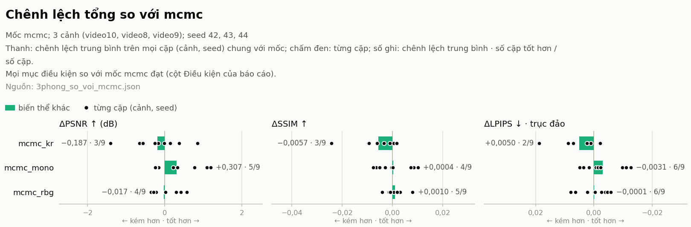

# Biểu đồ của `rooms_vs_mcmc` (tên gốc trên volume: `3phong_so_voi_mcmc.json`)

Lập từ `3phong_so_voi_mcmc.json` (src.evaluation.compare_modes), không đọc lại lượt chạy: số trên biểu đồ và trong các bảng dưới đây là số của báo cáo, hoặc tính thẳng từ các số đó (trung bình, độ lệch chuẩn và số cặp tốt hơn trên các cặp (cảnh, seed) của mục `pairs`, gộp các báo cáo cùng mốc). Số thập phân dùng dấu phẩy, số âm dùng dấu trừ (−). ↑: cao hơn là tốt hơn; ↓: thấp hơn là tốt hơn; trên biểu đồ chênh lệch, mọi khung đều "phải là tốt hơn" (trục LPIPS đảo chiều). Số từng cảnh, chi phí và dung lượng: các bảng của báo cáo. Biểu đồ chỉ trình bày số liệu, không tự kết luận phương pháp nào tốt hơn: điều kiện so sánh ở báo cáo (`docs/design/comparisons.md`).

Nhãn trong biểu đồ (tên thư mục lượt, bỏ `_s<seed>`; các báo cáo được gộp theo nhãn) và biến thể tương ứng trong bảng của báo cáo:

| Nhãn | Biến thể |
|---|---|
| mcmc | `mcmc<test-list>` |
| mcmc_kr | `mcmc[sr3d.kr=True]<test-list>` |
| mcmc_mono | `mcmc[sr3d.mono=True]<test-list>` |
| mcmc_rbg | `mcmc[random-bkgd=True]<test-list>` |

## 1. Chênh lệch tổng so với mcmc

- Mốc mcmc; 3 cảnh (video10, video8, video9); seed 42, 43, 44
- Thanh: chênh lệch trung bình trên mọi cặp (cảnh, seed) chung với mốc; chấm đen: từng cặp; số ghi: chênh lệch trung bình · số cặp tốt hơn / số cặp.
- Mọi mục điều kiện so với mốc mcmc đạt (cột Điều kiện của báo cáo).

**Cách đọc.** Thanh: chênh lệch so với mcmc, trung bình trên mọi cặp (cùng cảnh, cùng seed) mà phương pháp và mcmc đều có (các seed chung của từng cảnh, như bảng chênh lệch của báo cáo); chấm đen: từng cặp. Số ghi: chênh lệch trung bình, rồi số cặp tốt hơn / số cặp (PSNR, SSIM cao hơn; LPIPS thấp hơn; bằng nhau không tính). Mọi khung: phải là tốt hơn mcmc, trái là kém hơn (trục LPIPS đảo chiều vì LPIPS thấp hơn là tốt hơn); số ghi là chênh lệch thật (ΔLPIPS âm là tốt hơn). Các chấm nằm cả hai phía của 0, hoặc trải rộng so với độ dài thanh: chênh lệch chưa nhất quán giữa các cảnh và seed, trung bình chưa đủ để nói "tốt hơn". Số từng cảnh: bảng chênh lệch của báo cáo. Số trên ảnh đúng số ở bảng số cặp tốt hơn của báo cáo (Δ: trung bình ± độ lệch chuẩn theo cặp).

| Phương pháp | Cảnh | Seed | Cặp | ΔPSNR ↑ (dB) | ΔSSIM ↑ | ΔLPIPS ↓ | Cặp tốt hơn: PSNR · SSIM · LPIPS |
|---|---|---|---|---|---|---|---|
| mcmc_kr | video10, video8, video9 | 42, 43, 44 | 9 | −0,187 ± 0,651 | −0,0057 ± 0,0082 | +0,0050 ± 0,0067 | 3/9 · 3/9 · 2/9 |
| mcmc_mono | video10, video8, video9 | 42, 43, 44 | 9 | +0,307 ± 0,583 | +0,0004 ± 0,0067 | −0,0031 ± 0,0065 | 5/9 · 4/9 · 6/9 |
| mcmc_rbg | video10, video8, video9 | 42, 43, 44 | 9 | −0,017 ± 0,359 | +0,0010 ± 0,0035 | −0,0001 ± 0,0048 | 4/9 · 5/9 · 6/9 |

## Không vẽ

- Đối chiếu default với Inria: báo cáo không có phần đối chiếu (mốc không phải default, hoặc chưa có B0 tự chạy và cấu hình benchmark)
